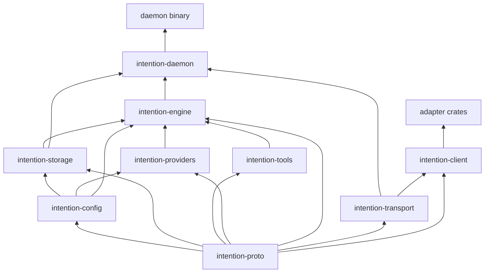

# Workspace and Crate Map

**Current policy.**

This document assigns ownership within the Rust workspace and defines allowed dependency directions. It implements the
workspace principle in [00 Principles and Scope](00-principles-and-scope.md) and the DTO-first rule in [02 DTO and
Contract Policy](02-dto-and-contract-policy.md).

## Rules

- Each crate owns one cohesive responsibility and exposes DTO-based public contracts.
- Dependency cycles are forbidden.
- An adapter may depend on `intention-client` and presentation-only crates, never on storage implementation, tools, or
  provider implementations.
- Concrete drivers are selected only by the composition root.
- Feature flags may choose implementations, but may not make the public contract type-unstable.
- `ConfigSnapshotDto` is the canonical credential-free persisted configuration selection: the composition root supplies
  one startup snapshot, and a turn that starts a run freezes that snapshot on the run row's `config_snapshot_json`.
  The snapshot's content is the run's configuration and nothing mints an identity for it. TOML is applied only at daemon
  startup, and live reload is not an accepted direction, so startup stays the only activation path.
- `intention-proto` owns the provider-neutral `UsageDto`, `FinishReasonDto`, `ToolCallDto`, and `ProviderErrorDto` that
  model and durable domain facts share; `intention-providers` re-exports them for its consumers.
- Domain, storage, and protocol never depend on `intention-providers`. SQLite stores assistant content, reasoning text,
  tool calls, and tool results on the transcript and tool-result rows rather than in typed envelopes or per-run cursors.
  `intention-engine` depends on the provider-neutral `intention-providers` contract only for its injected base execution
  service; it neither selects a concrete provider nor exposes an async runtime resource.
- `intention-daemon` may depend on the DTO, protocol, and transport crates needed to host selected execution and
  streaming, and on private Tokio/future support. It never depends directly on a concrete provider or storage
  implementation, selects no provider, and exposes no provider SDK, credential, Tokio, or storage resource in its public
  contract.
- The tool set is the closed six-variant `ToolId` (`read`, `write`, `edit`, `execute`, `glob`, and `grep`). No registry
  or reserved slot exists, and any other tool name is rejected as `unknown_tool` before effect.

## Crate map

The workspace has nine production crates, the `intention-tui` adapter, the non-production `intention-test-support`
fixture crate, and two future slots. Each crate's permitted dependency direction is the one its manifest declares, and
the root `Makefile`'s `COVERAGE_FLOORS` declares the line floor of every measured crate
([12 Quality Gates and Makefile](12-quality-gates-and-makefile.md)).

| Crate | Owns |
| --- | --- |
| `intention-proto` | Identity newtypes, shared value types, schema versions, run lifecycle and projection values, the typed public protocol DTOs, their typed serde payloads, and the typed tool contract (the closed `ToolId`, the typed input and result families, and each committed tool row's typed projection). |
| `intention-config` | TOML parsing, validation, resolved configuration, and credential-free snapshots. |
| `intention-engine` | Commands, queries, semantic use-case workflows, deterministic lifecycle decisions, interruption handling, and recovery. |
| `intention-tools` | The declared tools' model-facing JSON Schema descriptors, the cancellation-aware dispatch surface, and the `WorkspaceRoot` addressing policy, over the proto's typed tool contract. VFR and Headroom arrive here as modules at M7. |
| `intention-providers` | The provider-neutral model contract and both concrete SDK translation adapters. |
| `intention-storage` | Repository contracts and the bundled SQLite single-schema implementation. |
| `intention-transport` | Socket/pipe framing, the typed server/client wire, and subscriptions. |
| `intention-client` | Bootstrap, connection, dispatch, subscriptions, and reconnect, fully asynchronous and covering every protocol command and query. |
| `intention-daemon` | One composition holder that selects and connects configuration, SQLite storage, and the provider driver, plus the daemon host and binary. |
| `intention-tui` | The terminal application: one binary with a fullscreen revue UI, an interactive REPL, and a headless prompt mode over the shared client, and the owner of its own terminal theme, which it stores locally ([architecture 03](03-daemon-transport-and-adapters.md)). |
| `intention-test-support` | Non-production fixtures: credential-free fixture configuration, native temporary roots under `std::env::temp_dir()`, `TempDir`-backed durable databases, deterministic sessions, and bounded fixture listener orchestration. |
| `intention-tauri` (M6) | Tauri bootstrap and the minimal native bridge over `intention-client`. |
| `intention-plans` (M5+ Slice 3) | Plan artifacts, plan lifecycle records, and Plan/Build policy. |

Rules the map fixes:

- One composition location. `intention-daemon` is the only crate that selects concrete implementations and the only
  place that wires them, and the daemon host calls the engine directly.
- Boundaries own serialization. Only types crossing the three physical boundaries carry wire attributes: the IPC wire
  (`intention-proto` payloads served by `intention-transport`), SQLite rows (`intention-storage`), and provider SDK
  calls (`intention-providers`). Every other cross-crate call passes domain types.
- Tools exchange JSON only with the model. Tool inputs and outputs are schema-validated JSON; nothing else in the system
  carries an untyped JSON payload.
- Acyclic direction. Protocol and domain types are the lowest layer; configuration, storage, tools, and providers
  build on them; the engine builds on all of those; the daemon composes them; and no lower crate depends on
  `intention-engine`, `intention-daemon`, or `intention-client`.

## Ownership decisions

- `intention-storage` defines semantic, DTO-only operations such as create session, accept a user turn as started or
  pending, append pending turns to a run context, transition a run, recover unfinished runs, read the transcript and
  tool results, and load a run's frozen configuration snapshot. It does not expose a transaction closure, SQL
  connection, filesystem path, or backend resource.
- `intention-storage` owns bundled SQLite opening and direct creation of the single current storage schema,
  single-transaction state writes, and SQLite-only fault injection. It persists one canonical `WorkspaceId ->
  WorkspaceRootDto` association; the addressing semantics of that root are [architecture
  05](05-tools-and-workspace.md)'s.
- `intention-engine` decides valid run state edges and owns interruption handling: a stopped provider stream or tool
  call records a notice, resets its signal, and the run continues with its next model step. The repository owns run
  creation, pending-turn context joins, and recovery.
- `intention-daemon` exposes hidden `test-support` seams for an injected database, current-state inspection, and
  one-connection dispatch. Release production APIs and the daemon binary expose no fixture mode.

## Composition rules

`intention-daemon` is one crate with one composition holder plus the host. It creates and connects:

- resolved TOML configuration;
- SQLite storage, opened and recovered before ready;
- the one selected provider driver;
- command admission serialization;
- the host-owned per-run registry, single cancellation handle, and injected tool-execution port through which the
  engine runs its typed tool sequence over the six tool contracts. Composition selects concrete
  implementations; the binary owns process lifecycle.

This is the ownership boundary for the six active tools and the direct tool sequence. Base tools remain primitive
implementations; the engine owns lifecycle/result persistence and publication, and the plan owner and the VFR/Headroom
modules attach as ordinary calls when activated, not as extension points.

No other crate chooses a concrete SQLite driver, OpenRouter client, or adapter implementation by global construction.

## Binaries

Binaries are thin:

- `intention-daemon`: starts a configured daemon host.
- `intention-tui`: the terminal application; one command line selects the fullscreen revue UI (the bare command or
  `tui`), the interactive `repl`, or the headless `run <PROMPT>` mode, every mode reaches the daemon only through
  `intention-client`, and the process ends with one of the closed typed exit statuses.
- a future administrative CLI may use `intention-client`, not daemon internals.

The future `intention-tauri` crate (created at M6) is a desktop integration crate and binary host over
`intention-client`.

## Enforcement

The dependency manifests and rustc decide the dependency direction: a crate that names a foreign implementation crate,
a provider SDK outside `intention-providers`, or a composition-only concrete implementation outside
`intention-daemon`'s composition root fails to compile, and `cargo metadata` reports the same edges the manifests
declare. The root `clippy.toml` denies `clippy::disallowed_types` for untyped JSON and
`clippy::disallowed_methods` for the process working directory, so the DTO-first and `WorkspaceRoot` source rules fail
the lint gate at the exact line that breaks them. Provider-SDK ownership, DTO-only public boundaries, the acyclic
production graph, and the closed ordering-authority set are review responsibilities, checked against this map and the
manifests.

The exact test strategy and minimum test portfolio are defined in [10 Test-Driven Delivery and
Verification](10-test-driven-delivery-and-verification.md); the pinned tooling, coverage policy (per-crate line floors),
lint policy, and Makefile/CI contract in [12 Quality Gates and Makefile](12-quality-gates-and-makefile.md).

## Non-goals

This map does not freeze individual module names, file names, Cargo feature syntax, or exact trait method signatures;
those are implementation choices that must preserve these ownership and dependency rules.
