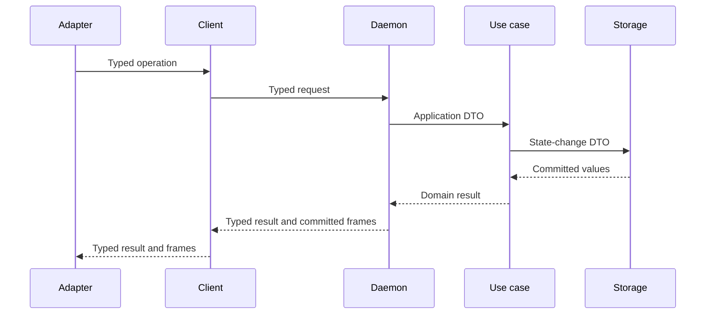

# DTO and Contract Policy

**Current policy.**

This document makes the DTO-first principle executable. It applies to the three physical boundaries: the IPC wire,
SQLite persistence, and provider SDK calls, together with the process and adapter edges that carry them.

## Non-negotiable rule

A boundary communicates through an explicit, strictly typed DTO. Passing an implementation type across a boundary is a
defect, even when both crates currently compile in the same workspace. Crates inside the process call each other with
domain types ([architecture 00](00-principles-and-scope.md), principle 2), and a type acquires wire attributes only
where it crosses one of the three boundaries.

A DTO is a stable contract, not merely any serializable struct.

## DTO categories

| Category | Purpose | Examples |
| --- | --- | --- |
| Command DTO | Requested state-changing work. | `SendUserTurnCommandDto`, `CancelRunCommandDto`. |
| Query DTO | Requested read model or snapshot. | `GetSessionSnapshotQueryDto`. |
| Persistence DTO | Storage-safe representation of a record or projection. | `RunProjectionDto`, `MessageProjectionDto`. |
| Provider DTO | Provider-neutral model request/stream/error contract, including advertised tool definitions and the transient same-run reasoning attachment. | `ModelRequestDto`, `ModelToolDefinitionDto`, `AssistantReasoningDto`, `ModelEventDto`. |
| Runtime execution DTO | Immutable selected execution input, safe terminal outcome, and provider-neutral time and transient text-delta ports over injected provider/storage contracts. | `ModelRunExecutionInputDto`, `ModelRunExecutionOutcomeDto`, `ModelTimePort`, `ModelTextDeltaPort`. |
| Tool DTO | Typed tool invocation, bounded result and interruption outcome, and the typed projection each committed tool row carries. | `ToolId`, `ToolInput`, `ToolResult`, `ToolRowDto`. |
| Config DTO | Parsed, validated, and resolved TOML configuration, and the credential-free snapshot a run freezes. | `ResolvedConfigDto`, `ConfigSnapshotDto`. |
| Presentation DTO | Explicit adapter projection, if transport DTO is not appropriate for display. | None today; adapters render transport projections directly. |

## Type rules

### UUID roles and non-conversion

UUID is an encoding/value representation, not authority. Every public UUID value uses a domain newtype whose owner
defines generation, scope, validation, and serialization. UUID equality never establishes semantic
identity across Session, Run, activity, lineage, graph, operation, or diagnostic domains.

Deterministic UUIDv5 is permitted only where the owner freezes its namespace and name derivation. Daemon-assigned/random
UUIDs and deterministic UUIDv5 values are not interchangeable. Historical UUID bytes and meanings remain unchanged and
cannot be normalized into future records. UUIDs, operation identities, and diagnostic correlation IDs are distinct
classes and must not be converted or used as authority substitutes. There is no durable ordering authority beyond
SQLite row insertion order — `messages.id` for the transcript — and no record family may introduce an ordering
sequence.

### IDs

All IDs are domain newtypes. No public cross-boundary API accepts an identifier as a bare `String`, integer, or UUID
primitive. The complete identity set is:

```rust
SessionId
RunId
TurnId
ProjectId
WorkspaceId
ToolCallId
MessageId
```

Every UUID identity is one newtype over `Uuid` that its owning boundary generates, and all of them parse and decode
through the one shared canonical-UUID path, which rejects any non-canonical spelling with `invalid_id`. Because that
path is also the deserializer, decode and explicit parsing cannot disagree. `MessageId` is the one non-UUID member: its
durable value is the positive SQLite `messages.id` the single durable writer assigned, it serializes as a JSON number,
and its constructor rejects a non-positive row id with `invalid_message_id`. The tool loop addresses model steps and
tool groups by plain indices within their containing records rather than by newtypes; provider-native tool-call
identifiers remain private implementation state.

### Envelopes

Transport messages are the typed `intention-proto` wire DTOs: one typed request enum and one typed result enum, a
correlated rejection carrying `ErrorDto`, and uncorrelated committed frames (architecture 03). Persisted state is stored
as plain typed rows; there is no durable event envelope, event identity, or event sequence.

A DTO field may be optional only when its absence has an explicit domain meaning. Optional must not conceal an
unimplemented relationship.

### Errors

Errors crossing a crate/process boundary are structured DTOs:

```text
ErrorDto
  code: stable machine-readable code
  category: validation | policy | not_found | conflict | unavailable | internal
  message: safe human-readable message
  retryable: whether repeating the same request can succeed
```

An error carries no dynamic detail payload: user-visible context is code-owned safe guidance, never a path, an OS
error, a command line, a stack trace, or file content. A tool failure is the one bounded exception: tool failures return the
workspace-relative path and the OS error verbatim, bounded; never the absolute root, a resolved symlink target, the
command line, or file content.

Messages are code-owned safe guidance. Runtime data must never be interpolated into `message` or placed in a
map/`serde_json::Value`. `Display` remains exactly `code: message`.

Provider secrets, filesystem content not intended for display, raw stack traces, and SDK objects never appear in
`ErrorDto`.

## Prohibited contract leaks

The following must not cross a boundary as public inputs or outputs:

- `serde_json::Value` or loosely typed maps as a replacement for a typed schema;
-  raw SQL rows, connection pools, transactions, file handles, `PathBuf` with unvalidated semantic meaning, Tokio tasks,
channels, mutex guards, or closures;
- provider SDK request/response/stream types;
- Tauri commands, window handles, Svelte stores, terminal widgets, or presentation state;
- bare strings for domain IDs, modes, risks, statuses, tool names, or tool kinds;
- implementation error types that reveal secrets or topology.

Provider SDK request/response/stream types and raw `serde_json::Value` cannot cross a provider boundary. M4
model/provider contracts use validated text context, requested/declared capability DTOs, ordered stream facts, usage,
finish reasons, safe provider errors, and typed JSON-object tool-call text. A request advertises tool definitions as a
validated JSON Schema descriptor (`ModelToolDefinitionDto`), never as raw `serde_json::Value`; the advertised set is
transient request state with no durable representation ([architecture 08](08-model-protocol-and-providers.md)). A
request may additionally carry the current round's
accepted provider reasoning as transient same-run attachment state with no durable representation: the runtime may
attach it to the assistant tool-call message of the same-run continuation ([architecture
08](08-model-protocol-and-providers.md)), and it is never durable history,
message text, or cross-turn transfer. The same-run scope is that DTO's shape today; replaying a session's earlier steps
is the open `@todo(provider)` of [architecture 08](08-model-protocol-and-providers.md), and it would pair each
attachment with the message it belongs to instead of a tool-call set. `intention-proto` owns the shared safe usage, finish-reason, tool-call, and
provider-error values; `intention-providers` re-exports them for its consumers. Native SDK decoding and JSON values
may exist only inside the owning provider implementation before being normalized to those DTOs.

Live session delivery is a current-state stream: `SubscribeSessionCommandDto` receives its correlated result as the
current session snapshot, and subsequent uncorrelated `SessionFrameDto` values carry `kind` `content` (one committed
transcript row), `kind` `status` (the committed `RunProjectionDto`, never a delta), or `kind` `text_delta` (one coalesced
chunk of the active run's uncommitted text) with no positions or cursors. A re-subscribing client re-reads current state
and continues live; there is no event tail, resync, or catch-up position.

## Validation ownership

Contracts are typed serde JSON DTOs. Public DTO deserialization is the structural validation boundary: required fields,
field types, and closed enum variants are established on decode and cannot be bypassed by a decoder. A semantic
invariant is enforced by the boundary that owns it; admission validates what its own decisions need from the values it
compares and does not re-validate every DTO it receives. The in-process model DTOs of `intention-providers` are the
recorded exception: they declare no decoder, and their typed constructors are their validation boundary.

There is no binary canonical form: the wire and domain contracts are the serde JSON DTOs themselves, and no tag
registry, canonical digest, or identity layer exists. Canonicalization is introduced only when a first real
consumer needs canonical bytes, and then only as RFC 8785 JSON Canonicalization (`serde_json_canonicalizer`); no
canonicalization dependency is added before that consumer exists. Until a real canonicalization consumer exists, no
component hashes JSON for identity, addressing, or comparison: equality is typed structural equality, and record
identity is the typed identity its owning boundary assigned rather than a digest.

The error category follows the boundary that detected the mismatch: a peer that does not speak the live local wire
fails as the typed `invalid_local_protocol_response` error with `ErrorDto { category: validation }` (architecture 03,
"Protocol lifecycle"), and a malformed request line is the same failure answered with a typed identity-less rejection.

Validation cannot be delegated only to UI. Tauri and TUI may provide ergonomic pre-validation, but daemon validation is
authoritative.

## Command lifecycle



A live frame is published only after the storage commit succeeds, carrying the values the commit recorded. The command
result and frames must include enough typed identity for an adapter to reconcile state.

## Versioning and compatibility

- Every transport schema and persisted row schema has exactly one live version, and that version evolves in place.
  Backward compatibility is neither offered nor required: there is no earlier payload shape to accept, no negotiated
  version, and no compatibility layer.
- Optional stays optional inside that one version. A current payload may omit an optional field, and the omission
  decodes as `None`; that is a property of the live schema, never an allowance for an earlier or later writer.
- Public DTOs tolerate unknown JSON fields unless a closed configuration schema or a closed provider value explicitly
  documents `deny_unknown_fields`. Required fields, invalid types, invalid IDs, unknown closed variants, and any stored
  schema other than the current one always fail safely.
- The typed local wire has exactly one live version and no version marker at all
([architecture 03](03-daemon-transport-and-adapters.md)): there is no negotiated protocol version, no handshake, no
per-payload `schema_version`, and no version byte in the endpoint name. Configuration and storage keep their own
explicit schema versions.
- SQLite storage is the single live schema (logical version 1) created
directly on open under one integer schema stamp; a database that does not carry the current stamp is discarded and
recreated from scratch, that discard is the only version gate, and no migration chain or older-schema open exists, while
persisted rows keep their recorded meaning.
- Provider DTOs are versioned independently from provider SDK models.

## Contract tests required before implementation

- round-trip fixtures for every request, result, and frame family;
- malformed-decode tests: invalid shape, invalid ID, unknown closed variant, and foreign bytes all fail closed;
- redaction tests for DTOs carrying configuration or provider context.

## Quality-gate integration

DTO validation, redaction, and public-API boundary tests are blocking `make verify` inputs. Every
DTO-owning crate is subject to its declared line floor, and contract fixtures run in the single feature
configuration.
See [12 Quality Gates and Makefile](12-quality-gates-and-makefile.md).

## Outcome criteria

A feature is not ready unless a Tauri bridge and TUI/REPL can invoke its same public command/query DTOs and interpret
the same resulting snapshot and frame DTOs without adapter-specific business rules.

See [03 Daemon, Transport, and Adapters](03-daemon-transport-and-adapters.md) for the process boundary, [10 Test-Driven
Delivery and Verification](10-test-driven-delivery-and-verification.md) for mandatory test layers, and [12 Quality Gates
and Makefile](12-quality-gates-and-makefile.md) for the blocking orchestration contract.
