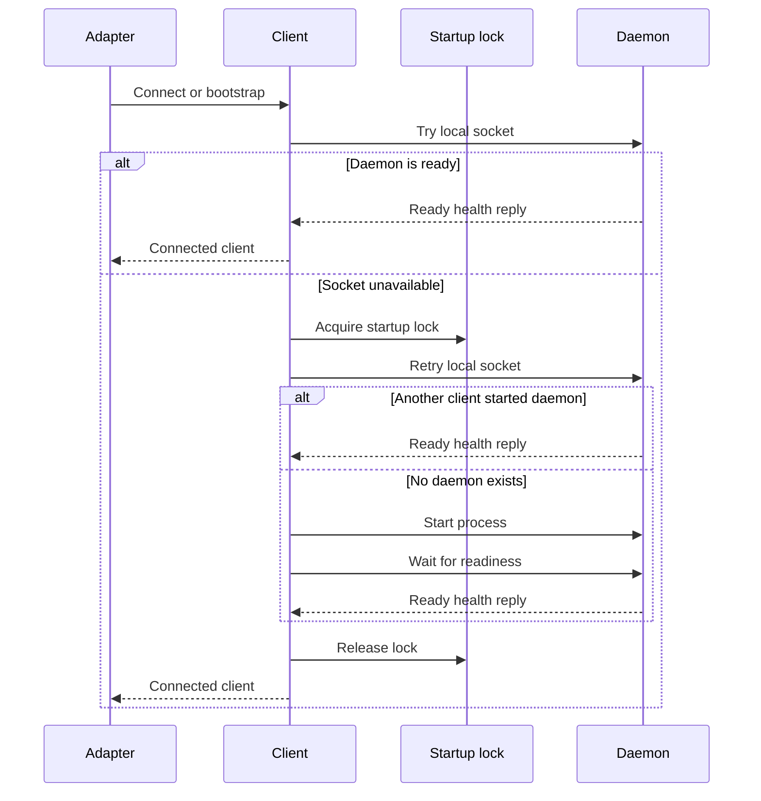
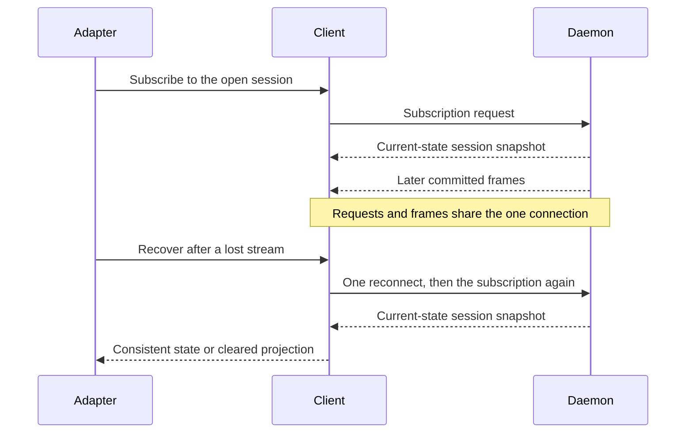

# Daemon, Transport, and Adapters

**Current policy.**

This document defines the local single-user daemon, the typed local process protocol, bootstrap and reconnect behavior,
and the responsibilities of Tauri, TUI, and REPL adapters. Web, Telegram, HTTP, WebSocket, remote authentication, and
multi-user operation are explicit v1 exclusions ([00 Principles and Scope](00-principles-and-scope.md)).

## Ownership

The daemon is the sole owner of application use cases and runtime actors; SQLite connections and persistence
transactions; active sessions and runs; provider drivers and model streams; the tool surface and workspace policy, plus
plan policy when activated; frame publication and subscription source; and protocol frames and
subscription current-state reads via `intention-transport`.

Tauri, TUI, and REPL own only presentation, user input adaptation, local display state, and reconnect UX.

## Local transport

v1 uses:

- Unix domain sockets on supported Unix platforms and named pipes on Windows;
-  logical safe endpoint identifiers resolved under the current user's platform runtime or application-configuration
  location, never exposed in public DTOs or safe errors;
-  Unix endpoint-parent mode `0700` and listener-socket mode `0600`; Windows relies on named-pipe local-user access
  semantics and is verified by the required Windows CI named-pipe fixture;
-  NDJSON framing: one typed message per `\n`-terminated UTF-8 JSON line, with one 1 MiB transport message cap
  (`MAX_MESSAGE_BYTES`) and no other framing rule;
- a typed local wire carrying only `intention-proto` wire DTOs, with no method table, no second error channel, and no
  handshake; the platform-default endpoint name is one fixed literal, `intention-relay`;
- OS-user filesystem permissions as the local access boundary.

No TCP listener is opened in v1. This avoids treating localhost as an authentication boundary and keeps remote API
design out of the initial product.

### Typed wire

Every message is one UTF-8 JSON line terminated by a newline. A client request is
`ProtocolRequestDto { id: u64, request: ClientRequestDto }`; a daemon reply is `ProtocolDaemonMessageDto::Reply`
carrying `ProtocolReplyDto { id: u64, result: ProtocolResultDto }`; a rejection is `ProtocolDaemonMessageDto::Rejection`
carrying `ProtocolRejectionDto { id: Option<u64>, error: ErrorDto }`; and a committed frame is
`ProtocolDaemonMessageDto::Frame(SessionFrameDto)`. `ClientRequestDto` and `ProtocolResultDto` are the whole operation
table: a request variant is the operation, and the reply variant is its typed result. No method-name string, no
`serde_json::Value`, and no untyped map crosses the boundary.

| Request variant | Request DTO | Result variant |
| --- | --- | --- |
| `CreateSession` | `CreateSessionCommandDto` | `SessionCreated` |
| `SendUserTurn` | `SendUserTurnCommandDto` | `TurnAccepted` |
| `CancelRun` | `CancelRunCommandDto` | `RunCancelled` |
| `GetSessionSnapshot` | `GetSessionSnapshotQueryDto` | `SessionSnapshot` |
| `GetDaemonHealth` | none | `DaemonHealth` |
| `ListSessions` | none | `SessionsListed` |
| `SubscribeSession` | `SubscribeSessionCommandDto` | `SessionSubscribed` |

The wire carries no terminal-theme operation: the theme is the terminal client's own presentation state, resolved and
stored locally, so the daemon never learns which palette a front end paints. A theme change records no durable
configuration either, and the local file it writes is not the credential-bearing `config.toml`.

`ListSessions` answers with the recency-ordered summary window (`SESSION_LIST_ROWS`) and an explicit `omitted` count,
so a bounded list is never a silent truncation; storage owns the ordering and the count, and the daemon passes the
result through unchanged.

Errors travel on exactly one channel: a rejection carrying the structured `ErrorDto` with its stable code, category,
retry guidance, and safe message. A request line that cannot be decoded is answered with a typed identity-less
rejection, and the connection keeps serving. The daemon never sends server-initiated requests, and batch arrays are not
part of this transport.

### Serving and liveness bounds

The daemon host accepts each local connection and serves typed requests. A one-shot connection reads one request,
writes the correlated reply or rejection, and closes; a long-lived connection may send further requests and receive
subscription frames. Each connection carries bounded liveness safeguards, not contract bureaucracy ([architecture 09](09-configuration-security-and-observability.md)):

- `MAX_MESSAGE_BYTES` (1 MiB) is the single owner of the envelope bound: it rejects an over-size message before unbounded allocation, the snapshot read stays byte-bounded below it (`MAX_TRANSCRIPT_SNAPSHOT_BYTES`), and an over-size correlated response is answered with a typed error instead of a silent close;
- `CONNECT_TIMEOUT` (500 ms) bounds the connect wait;
- a stale-socket probe reclaims an abandoned Unix endpoint only after proving no live listener owns it.

The transport is asynchronous end to end and applies no per-call read or write deadline, on Unix-domain sockets and
Windows named pipes alike: a peer that accepts a connection and then stops answering leaves the awaiting task pending,
and each caller owns its own bound (the client bounds every correlated and stream reply, and the daemon host bounds each
subscriber write).

### Asynchronous transport

This is the only transport implementation: the crate keeps the shared private `LocalEndpoint` mapping, the
`AsyncLocalListener`, `AsyncLocalClientConnection`, and `AsyncLocalDaemonConnection` types, and one `AsyncMessageSender`
plus one `AsyncMessageReceiver` link pair, and carries no synchronous twin. It uses the locked `interprocess` Tokio
feature with its private local Unix-socket / Windows-named-pipe mapping. After the connection splits, the link exchanges
typed wire messages; Tokio, interprocess, socket, endpoint-path, and I/O-half resources remain private to
`intention-transport`. There are no direction-specific connection roles and no feature negotiation: one connection
carries requests, replies, rejections, and frames alike.

Oversize messages are rejected before payload allocation or write; an incomplete or closed message stream is
`local_daemon_connection_unavailable`; a peer that does not speak the current wire is the typed
`invalid_local_protocol_response` failure. The connect wait is bounded exactly once, by the transport's own `CONNECT_TIMEOUT`. The transport preserves the
Unix modes and endpoint-reclaim rules above; an identity-verified probe at bind is the only stale-endpoint-removal path,
and a dropped listener never unlinks its endpoint. Its required transport test target exercises real endpoint
connections, ordered correlated request/reply exchanges, concurrent reader/writer use, frame delivery, framing safety
outcomes, and Windows named-pipe multi-message fixtures under `cfg(windows)`.

### Persistent subscriptions and the session live stream

A subscription is an ordinary typed request. `SubscribeSession` returns the current session snapshot as its correlated
result, and later committed state arrives as `SessionFrameDto` frames with `kind` `content` (one committed transcript
row), `kind` `status` (the committed `RunProjectionDto`, never a delta), or `kind` `text_delta` (one coalesced chunk of
the active run's uncommitted text) and no positions. Only the `text_delta` frame is transient; the other two carry
committed values. A status publication builds its frame from the committed run projection the transition returned and
reads nothing else. A committed tool-call or tool-result row is followed by that run's current committed projection
reread from durable storage, so its open-call count reflects storage's read-time pairing of committed calls and
results; a failed refresh publishes nothing and the next commit or the terminal frame repairs it. One subscription
follows one session and carries every row committed in it, whoever committed it -
this window's turn, another window's turn, or the daemon's own lifecycle - so a second window on the same session sees a
turn it did not send without asking for anything. A re-subscribing client re-reads current state and continues live;
there is no cursor, event tail, or resynchronization. An unknown session is a typed rejection, cross-session frames are
rejected without mutating the client's projection, and a session with no active run stays subscribed and silent until
something commits.

A step's pending deltas flush before that step's committed `content` frames, reasoning ahead of answer; a run with no
subscriber retains no provisional text, and a client applies a chunk only while its frame names the run that client
currently projects.

`intention-daemon` owns one private Tokio runtime and serves the typed wire from one `AsyncLocalListener`. Each
subscriber has a private bounded outgoing queue (`SUBSCRIBER_QUEUE_CAPACITY`, 64), its own writer path, and a bounded
write deadline (`SUBSCRIBER_WRITE_DEADLINE`, 10 seconds); these are implementation safeguards owned by the host, not
product ceilings. An overflowing, closed, or timed-out subscriber is removed without awaiting it from execution,
persistence, or healthy subscriber delivery. Queue-capacity isolation and the paused-clock deadline are daemon-host unit
evidence; the persistent-host outcome fixture proves a real healthy local peer's subscribe/live/reconnect-read lifecycle
rather than OS-buffer timing. The transport message bound and local Unix-socket/Windows-pipe permissions are unchanged.

Test-only restart fixtures explicitly abort and join all first-host connection and execution tasks before dropping every
first-host facade clone and reopening the database; this is deterministic fixture lifecycle ownership, not a production
signal-handling claim. Admission and interruption semantics are owned by [architecture
04](04-sessions-runs-events-and-storage.md).

## Shared client

`intention-client` is the only supported client-side integration path for local adapters. It owns:

- daemon discovery and bootstrap coordination, including the declared endpoint instance the process addresses (the
  `INTENTION_ENDPOINT` identifier, falling back to the platform-default endpoint) and the daemon program source it
  launches (the terminal binary's sibling `intention-daemon` program by default);
- typed operations over domain identifiers, never wire DTOs in adapter signatures;
- typed session-stream subscriptions, the one reconciled committed-row list with its one retention bound, and the
  frame-advance report a consumer follows;
- the continue target an explicit continuation resolves, so no adapter re-derives it from a session list;
- reconnect behavior;
- snapshot recovery;
- local transport error classification, including the closed stream an unobservable run reports.

It must not contain Svelte, terminal, or domain workflow behavior.

## Bootstrap sequence



### Bootstrap requirements

1. The adapter first attempts a connection without spawning anything.
2. A cross-platform `fs4` advisory startup lock prevents duplicate daemon launches.
3. The lock holder rechecks availability before creating a daemon.
4. It launches the daemon process only when the recheck still finds no daemon, with the program source the client
   declares: by default the terminal binary's sibling `intention-daemon` program.
5.  Readiness requires one correlated health request answered with `DaemonHealthDto`, so the answer itself is the
   ready state; process existence is not readiness.
6. Startup errors are typed and safe to render.
7. Closing one adapter never terminates a healthy shared daemon.
8.  Idle shutdown, explicit stop, and connected-adapter upgrade coordination are deferred; the M2 default is daemon
   persistence until process termination or OS shutdown.

## Protocol lifecycle

There is no handshake, no version negotiation, and no capability DTO, feature flag, family gate, or connection mode:
the typed request enum is the whole protocol, and both peers are built from this source tree.

One protection covers a peer from another build: the fail-closed decode. The endpoint name is one fixed literal
(`intention-relay`) that no build varies, and the wire evolves in place, so a peer that answers on the current
endpoint with bytes this build cannot decode is rejected with the typed `invalid_local_protocol_response` error
(`category: validation`) instead of being reinterpreted. There is no version byte, negotiation, handshake, or version
check. The adapter should offer a safe restart/reconnect action and never silently reinterpret mismatched payloads.

The client sends typed requests, and committed frames arrive on the same connection after a session subscription. The
client applies live frames after the result it received and re-reads current state after a reconnect.

### Current-state session read

There is exactly one session read: `GetSessionSnapshot` returns the **current durable projection snapshot** for the
session. It is not a retained connection and not a live event feed, and the very same `SessionSnapshotDto` is the
snapshot a subscription answers with: one shape serves the one-shot read and the stream's opening state. Committed values
are published only through the daemon host's commit-observation path, and every committed row of a session is published
to that session's subscribers.

A session projection names the session's active run at the moment of the read, and that run's projection arrives as a
status frame when it changes. No scoped run read exists beside the session read: one run's state is read through the
session it belongs to.

## Subscription and reconnect

A subscription is scoped to one session, and the client holds at most one active subscription per session.



### Reconciliation rules

- Adapters render committed state; a reconnect re-reads current state instead of replaying a tail.
- Duplicate or stale frames do not mutate a projection that already reflects newer committed state.
- Adapters never synthesize server state or ordering.
- One window, one session stream: two terminal windows on the same session follow it independently, so a turn sent in
  either reaches both, and either one can stop the run they both observe.
- A lost stream is not a dead end: the front end asks for exactly one reconnect per lost stream - bootstrap, open the
  session, subscribe again - reports a failed reconnect's typed error, and stays usable with its exit arms reachable. The
  one-reconnect budget is restored only by a frame the stream delivers, never by a subscription that merely opened: a peer
  that accepts a subscription and closes it without delivering a frame is reported with the front end's typed failure
  after the original bootstrap and its one reconnect.

## M3 durable authority

The M3 composition facade is daemon-owned durable state: it opens the platform state database, holds the one
credential-free startup configuration snapshot that each run admission freezes on its run row, completes recovery
before reporting ready, and serves the typed request/result contract from SQLite. The facade uses the platform
application-state location (`XDG_STATE_HOME` or `~/.local/state` on Linux, Application Support on macOS, and
`LOCALAPPDATA` on Windows); it returns a typed unavailable error when no absolute platform location is available and
never falls back to process CWD.

`intention-test-support` owns durable fixture construction and bounded listener orchestration. It constructs
credential-free configuration snapshots, platform-native temporary workspace roots, `TempDir`-backed databases, and
known sessions; fixture hosts run through the crate's one `cfg`-gated fixture host lifecycle, which aborts and joins
every connection and execution task the host created. TUI and daemon binary tests do not own a parallel fixture
protocol or a fixture startup CLI mode. M3 does not implement
idle shutdown, an explicit daemon-stop command, or model or provider execution; M4 persistent delivery is provided
through the session live stream.

## Tauri bridge

Tauri is a bootstrap/native bridge, not a domain host.

```text
Svelte UI → Tauri invoke/event bridge → intention-client → local daemon
```

The Rust bridge may initialize `intention-client`; call its typed session, turn, and run operations; forward typed frame DTOs; map
explicit presentation DTOs when necessary for JavaScript ergonomics; and manage window, native dialog, notification, and
app lifecycle details.

The bridge must not import application use-case services directly; create a competing SQLite connection or run actor;
invoke provider SDKs or tools; reimplement persistence, plan, workspace, or tool-transform policy; or
introduce a parallel Tauri-only command contract.

## TUI and REPL

TUI and REPL connect directly through `intention-client`. They are equal presentation adapters, not special daemon
modes, and must use the same typed client operations, snapshots, and frame DTOs as the Tauri bridge. This is an intentional
architectural proof that presentation logic is isolated.

`intention-tui` is one binary with one command grammar and selects exactly one front end: the bare command or `tui`
starts the fullscreen UI, `repl` starts the interactive line loop, and `run <PROMPT>` runs one headless prompt. Every
mode takes `--workspace PATH`, `--session ID`, `--continue`, and `--mode plan|build`; `--theme auto|light|dark` belongs
to `tui` alone, and `--timeout SECS` and `--format text|json` belong to `run` alone. `--session` with `--continue` is a
usage rejection, and so is a fullscreen launch without a terminal on standard input and output. Every mode ends with
one closed process status: 0 completed, 1 usage, 2 daemon or transport, 3 typed rejection or failed run,
4 timeout with no observed terminal status, 5 interrupted run. The terminal application's own
rules - window, transcript, palette, theme resolution and picker, command band, pastes - are owned by
`crates/intention-tui/README.md`.

## Daemon restart semantics

On daemon startup, before it answers its health projection:

1. resolve and open the platform state database, creating the complete current storage schema directly on open;
2. hold the credential-free startup `ConfigSnapshotDto` that every run admitted from then on freezes on its run row;
3.  transition each pre-existing unfinished run to `interrupted` through the repository's mandatory
   terminal-transition transaction;
4.  do not automatically retry or resume model calls, tool calls, shell processes, or other external work; pending
   turns stay durable input and start no work during recovery; and
5. make the recovered state available through later one-shot current-state reads.

This policy is honest about unknown external side effects. A user may initiate a new retry or manually reconciled
follow-up run.

## Required tests and observable outcomes

| Requirement | Test evidence | Observable result |
| --- | --- | --- |
| Shared daemon | `intention-test-support` fixture-host integration and TUI client test connect to one fixture daemon with an explicit test-only session ID. | Both observe equal typed health and snapshot DTOs for the same session. |
| Startup race | Multi-client bootstrap integration test. | Exactly one daemon host is created. |
| Permission boundary | Socket/pipe permission integration test. | The endpoint file and its parent directory are owner-only on Unix. |
| Foreign peer | Client/server compatibility test. | A foreign peer on the current endpoint fails with the typed `invalid_local_protocol_response` error. |
| Wire conformance | Typed-wire contract and rewritten transport integration tests. | Every request kind round-trips with its named result kind, malformed lines are answered with typed rejections, and frames carry committed values without positions. |
| Reconnect | Subscription integration test. | A new request receives the current durable snapshot, a reconnect re-reads current state, and no request claims replayed history. |
| Restart | Persisted active-run recovery test. | Recovery completes before ready; every pre-existing unfinished run becomes `interrupted`, pending turns stay durable input, and no provider/tool call resumes. |
| State location | Platform-state path fixture. | The database resolves under AppData/platform state and fails safely without an absolute platform directory, never using CWD. |
| Adapter isolation | Dependency/contract test. | The TUI adapter has no direct runtime/storage implementation dependency. |

## Quality-gate integration

The daemon, transport, client, and adapter tests in this document are blocking `make verify` inputs under the coverage
policy of [12 Quality Gates and Makefile](12-quality-gates-and-makefile.md) (per-crate line floors). `intention-tui`
carries its 20% line floor in addition to its mapping contracts and fixture-daemon outcome scenarios; the floor never
replaces that evidence.

## Open implementation decisions

- durable endpoint cleanup and stale-listener recovery policy beyond listener ownership safeguards;
- daemon upgrade coordination with connected adapters: the restart ordering and the reconnect an adapter performs
  after a fail-closed decode;
- explicit daemon stop command and future idle shutdown policy.
