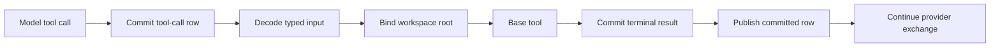

# Tools and Workspace

**Current policy.**

This document specifies typed core tools, `WorkspaceRoot` addressing semantics, and tool execution policy.

## Tool ownership

The typed tool contract lives in `intention-proto` ([architecture 02](02-dto-and-contract-policy.md)): the closed
`ToolId`, the typed input and result families, the tool-result lifecycle status with its metadata entries, and the
typed call/result projection every committed tool row carries. `intention-tools` owns:

- the six declared tools' model-facing JSON Schema descriptors and their model-visible spec match;
- the execution interfaces over the typed input, including the workspace-root binding each invocation receives.

Tools are domain/runtime capabilities, not UI commands. An adapter only renders the committed tool rows the daemon
publishes, and their typed projection is what it renders.

## Core tool contract

M5 activates six executable tools: `read`, `write`, `edit`, `execute`, `glob`, and `grep`. No other tool id exists:
a name that is not one of these six is rejected as unknown before any effect.

Every tool has:

```text
ToolSpec
  id
  description
  input_schema   (JSON Schema rendered from the typed input)

ToolId
  read | write | edit | execute | glob | grep

ToolInput
  read | write | edit | execute | glob | grep  (typed per-tool parameters)

ToolDispatchOutcome
  completed(ToolResult) | interrupted(cause, partial)
```

A model-visible tool's arguments are defined once, by the typed input DTO that decodes them, and `input_schema` renders
the JSON Schema document of that one definition, so the document the model sees and the decode that admits the call
cannot disagree. `intention_tools::model_visible_descriptors()` returns exactly those six tool specs in advertisement
order, and `intention_tools::spec(id)` is the single place where a tool's description is defined. Ordinary model
requests advertise that set as typed tool definitions
([architecture 08](08-model-protocol-and-providers.md)).

The concrete Rust API can use traits and generic DTOs, but no tool entry point accepts untyped tool inputs or results.

## WorkspaceRoot is a required addressing anchor

A session's `WorkspaceRootDto` is passed to every tool that reads, writes, searches, expands, or executes against a
local path/process.

### Required behavior

- `resolve_path(relative) = workspace_root.join(relative)`: exactly one
resolution rule, no per-path canonicalization, and no per-tool alias;
- exactly one `WorkspaceRoot` exists per session, and every tool resolves against it;
- tools must not use process `pwd` as a fallback;
- absolute and parent (`..`) paths never reach a tool: the typed path shape
(`WorkspaceRelativePathDto`) rejects them, which is an input-shape rule and not a boundary;
- symbolic links are ordinary filesystem material: no lexical symlink parser,
no containment check, and no fail-closed path rejection exists, so a relative path that names a symbolic link may
resolve outside the root;
- `glob` and `grep` with no explicit path search from `workspace_root`; the
default scope decides what a pathless call addresses, not what the process may read;
- `execute` starts with `cwd = workspace_root` unless the call declares a `cwd`, and inherits the invoking process
environment with the call's own declared variables overlaid by name. WorkspaceRoot is an addressing anchor and
default CWD, not a security, environment, or privilege boundary.
- the committed tool-call row identifies the logical path/CWD the call used;
- plan artifact storage is not implicitly included in `workspace_root`; it is authorized by mode policy.

### Project script library

The project script library is the logical, slash-separated, workspace-relative path `.ir/scripts` under
`workspace_root`, with `.ir` as the project-local hidden root for agent-authored reusable material
([architecture 20](20-ipython-kernel-lifecycle.md)):

- the convention names a location only; the library is not implicitly included
in, or excluded from, any other policy, and no plan artifact, daemon state, checkpoint, or configuration lives there;
- modules are created and edited only through `write` and `edit`, read through
`read`, `glob`, and `grep`, and run through `execute`; the relative-path addressing rules above apply unchanged;
- a tool call or error identifies a module by its logical relative path,
like every other workspace path; and
- `write` and `edit` remain incompatible in Plan mode, so library mutation stays
Build activity.

A raw `PathBuf` alone is not a workspace contract. It must be wrapped in an input DTO with semantic intent and be bound
to the workspace root before execution.

WorkspaceRoot is an anchor for addressing, not a security boundary: the daemon and its child processes run with the
user's ordinary OS authority. Real isolation, if it is ever required, must be an OS-level boundary such as a sandbox,
container, or ACL, never a lexical path check.

### Failed workspace operations

A failed workspace operation uses `ErrorDto` with its existing stable code and a message that names the target it
addressed — the workspace-relative path, or the `glob` pattern — and the underlying OS or pattern error verbatim: a
read that cannot open or read its target reports `tool_read_failed` with `unable to read {path}: {error}`. The message
never carries the absolute workspace root, a resolved symlink target, the command line, or file content; the guidance
rendering below bounds what the model sees.

A failed call is durable, model-visible evidence rather than a stopped run: the application commits one terminal
`Failed` result whose content is bounded guidance rendered by `tool_failure_guidance` (the typed failure message, the
failed tool identity, and a code-owned suggestion), and the model loop answers the call with that content before
continuing. The guidance is tool-result content, not an `ErrorDto` payload: its only dynamic detail is that same
addressed path and error, and it stays inside `MAX_TOOL_GUIDANCE_BYTES`.

## Tool pipeline



<!-- Base tools do primitive work only; the application owns the durable sequence. -->

Ordinary model requests advertise the model-visible spec set as typed tool definitions. The model-tool loop feeds this
pipeline: a provider-emitted tool call becomes a typed invocation built by the application, executes through the
daemon-owned tool service, and its durable result is persisted before publication and returned to the provider exchange
as a tool-role message. Provider adapters never execute local tools. The runtime owns the provider continuation until the
provider finishes. Every workspace tool checks the invocation's cancellation signal before and between its I/O steps and
returns its captured output as a partial result when stopped.

### Tooling execution API and status rendering

`intention-tools` exposes exactly one current execution surface: the cancellation-aware dispatch
`ToolService::dispatch_with_cancellation(input, cancellation)` returns a typed `ToolDispatchOutcome`
(`completed(ToolResult)` or `interrupted(cause, partial)`), and the application renders each completed result into the
bounded, redacted text its durable rows carry. Every executed program is classified by the proto's typed `ToolProcessStatus`
(`success`, `non_zero` with its numeric code, or `signal` with its recorded signal), which rides the execute result on
the committed row. The execute result's text rendering is derived from that same typed status, so the text and the
typed classification can never disagree and no arbitrary sentinel exit code is invented for signal termination.

`execute` takes one `ShellCommandTextDto` plus optional typed launch parameters (`cwd`, `env`, `timeout_seconds`). The
platform shell adapter (`bash -c` on Unix, `cmd /C` on Windows) is private tool code: pipelines, redirects, and
compound commands are ordinary tool semantics, and no executable path or platform resource crosses a DTO boundary. A
call without a declared timeout has no deadline; run cancellation and the child's own exit are its only stops, and the
declared timeout is the one working deadline a call can carry. A fired declared deadline is its own observed cause: the
tool terminates the program and returns the captured output as a partial result whose notice names the timeout, while a
caller stop observed at the same moment stays the caller's stop, so the deadline never reads as lost evidence.
`READER_DRAIN_GRACE` bounds one pipe-collection window
after the direct child is reaped: a descendant that inherited the pipes can never extend the call, and a window that
runs out stops the process group while keeping whatever the readers captured.

## Execution order and extension points

The application owns the base tool pipeline as one direct typed sequence: decode the model's exact arguments document
once into the typed input, commit the tool-call row with that document and its typed projection, bind the workspace
root, dispatch once through `intention-tools`, commit the terminal result row (completed, partial, or failed with its
bounded guidance) with its typing and its answering transcript row, and publish the committed row. `intention-tools` owns no registration, ordering, phase,
context, or dispatcher mechanism, and the production path has no phase dispatch site.

WorkspaceRoot binding, VFR transformation, Headroom compression, and Plan-mode authorization are therefore ordinary
calls, not extension points. Each attaches only when a phase has a behavioural owner with a contract to test; the
`intention-plans` owner and the VFR/Headroom modules of `intention-tools` are not active implementations today
([architecture 15](15-tool-registry-and-model-tool-loop.md)).

## Policy separation

The following must remain distinct:

| Concern | Owner |
| --- | --- |
| Tool's primitive work | Base tool implementation. |
| Path addressing and CWD | WorkspaceRoot binding in the application. |
| Plan-mode mutation authorization | Plan policy. |
| Compression and retrieval metadata | Headroom module (`intention-tools`). |
| Virtual source transformation | VFR module (`intention-tools`). |
| Persistence transaction | Application/storage. |
| UI rendering | Adapter. |

## Trusted workspace boundary

v1 does not sandbox tools or containerize processes. `WorkspaceRoot` anchors relative addressing, starts `execute` at
the root, and scopes pathless `glob`/`grep`; it does not contain absolute paths, parent paths, or symbolic links, and a
shell command can still interact with the wider user environment. This limitation is explicit in Plan and Build
Autopilot. Plan's advisory instruction is not a technical boundary.

## Required tests and outcomes

| Requirement | Test evidence | Observable outcome |
| --- | --- | --- |
| Relative resolution | Tool contract test with changed process CWD. | A relative path resolves from the declared root, never from process CWD. |
| Addressing anchor | Tool coverage test. | A pathless `glob`/`grep` searches from the root, so the default scope decides what a pathless call addresses. |
| Execute CWD | Process fixture test. | Child process observes the workspace root, or the call's declared `cwd`, as its CWD. |
| Shell semantics | Tool contract test. | Pipelines, redirects, and compound commands run through the platform shell. |
| Recoverable call failure | Engine lifecycle and daemon end-to-end tests. | An undecodable, denied, or failed call commits one terminal `Failed` result with bounded guidance and the next model step proceeds. |
| Pre-effect rejection | Application integration test. | An unknown tool id is rejected before any external effect and still leaves the durable call row and one guided `Failed` result. |
| Adapter independence | Daemon tool-stream contract test from the TUI client. | The adapter sees the same committed tool results the daemon owns. |

## Quality-gate integration

Tool and WorkspaceRoot tests are blocking `make verify` inputs under the coverage policy of [12 Quality Gates and
Makefile](12-quality-gates-and-makefile.md) (per-crate line floors). Direct process-CWD fallback is rejected by the
compiler, through the `clippy.toml` entries that deny `std::env::current_dir` and `std::env::set_current_dir`; that base
tools stay free of transform behavior is a review responsibility. Line coverage cannot replace the explicit
relative-addressing, search-scope, execute-CWD, and policy-denial scenarios above.

## Open decisions

- exact capability taxonomy and audit policy for `execute`, network, and
destructive file actions. Build Autopilot does not use per-action confirmation; Plan `execute` is advisory-guided and
trusted-local.

## Autopilot tool boundary

Build Autopilot intentionally removes per-action confirmation for the configured Build surface. No phase can add
discretionary confirmation or risk authorization between the identity check and the tool dispatch. The tool contracts, the
model-visible set, and the loop details are owned by
[Tool registry and model-tool loop](15-tool-registry-and-model-tool-loop.md). Plan `execute` remains available under advisory focus guidance and is not a sandbox;
ordinary Plan `write` and `edit` remain denied.
