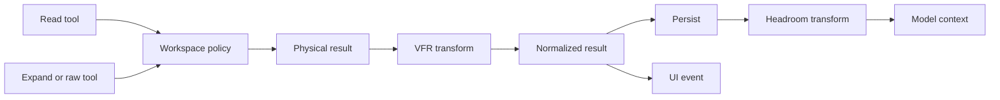

# VFR and Headroom

**Approved future design. Not implemented; VFR and Headroom arrive at M7 as modules of `intention-tools`, and
activation requires an activating specification.** Virtual File Representation (VFR) and Headroom/CCR are required v1
capabilities delivered as ordinary library calls inside the tool pipeline, not as separate extension crates attached to
it. The design has no typed hook plane; the stages below describe the call
order, not a hook framework ([architecture 05](05-tools-and-workspace.md)).

## Design principle

Base tools perform their primitive work. The two modules transform results at controlled phases inside the
`intention-tools` crate.

VFR changes a suitable source-file read into a structured virtual representation. Headroom changes suitable retained
model context into a compressed representation with retrievable originals. They solve different problems and must not be
conflated.

## Ownership and non-authorities

Architecture 05 owns the tool pipeline and workspace policy; the VFR and Headroom modules are ordinary library
functions called by that pipeline, and base tools never take a private dependency on either transform. Architecture 30
owns the frozen instruction text; this document contributes the `Vfr` contribution text and no assembly order.

## VFR module

### Responsibilities

The VFR module owns:

- eligibility evaluation for file read results;
- typed virtual representation DTOs;
- source map/hidden segment metadata;
- expansion and raw-read tool contracts (`expand` and the raw-read path, delivered as future `ToolId` variants);
- the instruction contribution assembled into the frozen instruction text of [architecture
30](30-instruction-sources-and-system-context.md);
- tests proving loss-aware, deterministic transformations.

### Required behavior

- VFR receives a read result after `WorkspaceRoot` path validation.
- It transforms only eligible source files according to resolved configuration.
- It creates a virtual representation that preserves enough stable reference data for later expansion.
- It does not mutate the physical file or base `read` tool semantics.
- The model receives explicit instructions describing placeholders and the `expand`/raw path, delivered only as the
  declared `Vfr` contribution of architecture 30's instruction text.
- A user-visible tool result remains traceable to the physical normalized file path and VFR transform decision.

### Supporting tools

- `expand`: obtains requested represented sections through a typed VFR reference.
- raw-read path: reads the full allowed source without applying the presentation transform, subject to WorkspaceRoot
  and normal policy.

The final user-facing tool names and DTO fields may differ, but they must retain these semantics.

## Headroom module

### Responsibilities

The Headroom module owns:

- typed compression eligibility and transform decisions;
- the CCR read-through view contract and its implementation selection;
- references and retrieval metadata;
- the `retrieve` tool contract;
- safe compression observability.

### Required behavior

- Headroom runs after a normalized tool result is available.
- The durable tool result is the record. The CCR store is a bounded read-through view of it: it adds no retention
  policy, no rotation, and no expiry, and it owns no lifecycle of its own.
- A compressed model-context representation refers to the durable tool result, and the model receives a typed
  reference when recovery is available.
- `retrieve` resolves one or more references to their durable tool results, or returns a typed missing error.
- Headroom does not erase the audit trail of the pre-compression result.
- The view carries no size bound of its own: the durable result's own output window bounds what it can return, and a
  storage failure is an explicit typed outcome.

## Deterministic extension ordering

| Order | Stage | Owner | Result |
| ---: | --- | --- | --- |
| 1 | Path/CWD policy | `intention-tools` | Safe resolved invocation. |
| 2 | Primitive execution | Base tool | Physical result. |
| 3 | Virtual source transform | VFR module (`intention-tools`) | Normalized VFR or original result. |
| 4 | Persist normalized result | Application/storage | Durable audit/query value. |
| 5 | Compress model context | Headroom module (`intention-tools`) | Model-specific compressed/reference value. |
| 6 | Publish adapter event | Runtime/transport | Agreed human-readable result and metadata. |

The v1 default presentation policy: adapters receive the normalized result, including VFR representation where
applicable; the model may receive a further Headroom-compressed representation; event metadata exposes that compression
occurred without leaking CCR internals or secrets; a future product decision may add an explicit UI affordance for
original/retrieved content.

## Data boundaries

| Representation | Storage purpose | Adapter visibility | Model visibility |
| --- | --- | --- | --- |
| Physical tool result | Ephemeral primitive output. | Indirect/auditable as policy permits. | No direct guarantee. |
| Normalized result | Durable tool record after VFR. | Yes, by default. | Candidate input. |
| Compressed result | Headroom-specific context. | Metadata only by default. | Yes, when selected. |
| CCR original | The durable tool result, read through the CCR view. | Not automatically. | Only through `retrieve`. |

## Failure behavior

- An invalid VFR mapping fails back to a normal safe read result or a typed tool failure according to configured fail
  policy; it never emits an unresolvable placeholder.
- A reference is offered only once its durable tool result is committed, so a compressed reference never points at
  content the record does not carry.
- A reference that resolves to no durable tool result returns a typed, observable result; it does not fabricate
  recovered content.
- A transform failure records which stage failed without exposing source content or secrets in normal diagnostics.

## Required tests and outcomes

| Requirement | Test evidence | Observable outcome |
| --- | --- | --- |
| VFR independence | Read tool test with VFR disabled/enabled. | Base read succeeds without linking VFR behavior into its implementation. |
| VFR round trip | Fixture/property test for representation plus expand. | Expanded sections map to the original allowed source. |
| Raw path | Workspace/VFR integration test. | Raw read obeys workspace policy and returns full permitted content. |
| Headroom retrieval | Compression/CCR test. | `retrieve` returns the durable tool result the reference names; an unresolved reference returns the typed missing outcome. |
| Ordering | Full pipeline integration test. | VFR precedes persistence and Headroom precedes model-context insertion. |
| UI/model distinction | Event and model-request capture test. | Adapter sees normalized content; model receives intended compressed content. |
| Disabled extensions | Feature/config test. | Tool pipeline remains correct with each extension independently disabled. |

## Quality-gate integration

The VFR and Headroom modules live in `intention-tools` and are covered by its declared 60% line floor; their
transform, retrieval, ordering, and adapter/model distinction tests are blocking `make verify` inputs in the
single feature configuration. Base tools stay free of transform behavior as an organization and review rule, not a
separate crate boundary. See [12 Quality Gates and Makefile](12-quality-gates-and-makefile.md).

## Dependencies and non-goals

Depends on [Tools and Workspace](05-tools-and-workspace.md) and [architecture
30](30-instruction-sources-and-system-context.md). Non-goals: conflating VFR with Headroom, separate extension crates,
and any base-tool private linkage to either transform.

## Open decisions

Deferred with `@todo` markers in the modules when they land:

- exact VFR language set and size thresholds;
- CCR backend;
- which metadata becomes visible in UI;
- whether content is encrypted at rest in a later version;
- exact fallback policy for VFR parser failures.
