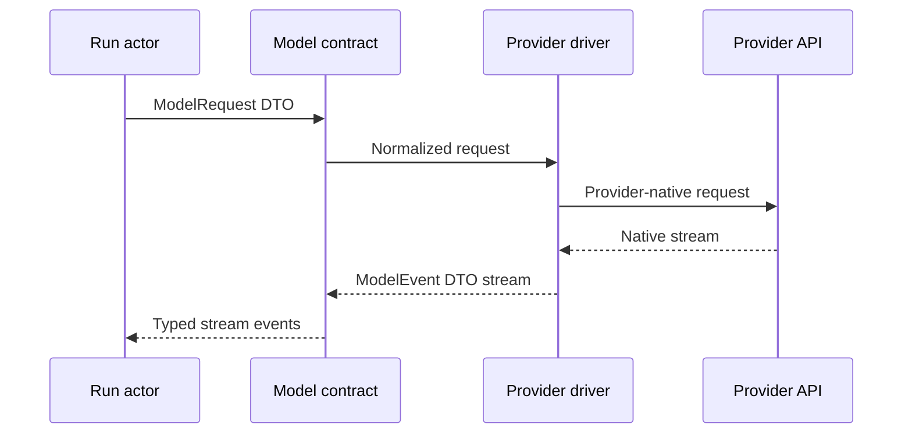

# Model Protocol and Providers

**Current policy.**

This document defines the provider-neutral model contract and the first provider adapters. It preserves meaningful
provider capabilities rather than forcing all models into a lowest-common-denominator Chat Completion abstraction.

## Canonical model contract

`intention-providers` owns typed requests, stream events, capabilities, and the provider-driver trait. `intention-proto`
owns provider-neutral `UsageDto`, `FinishReasonDto`, `ToolCallDto`, and `ProviderErrorDto`, which `intention-providers`
re-exports for source compatibility. `intention-proto` owns the durable projections and the transcript-row representation.
Storage and proto retain no dependency on `intention-providers`.

```text
ModelExecutionDriver
  capabilities() -> ModelCapabilitiesDto
  execute(ModelRequestDto, ModelCancellationSignal) -> ModelEventStream
```

The contract defines text-only `ModelMessageDto` context and an optional system context. Every provider stream starts
with `Started`, then zero or more text/reasoning/tool/usage events, followed by exactly one terminal `Finished` event.
The crate-private `stream` module (`crates/intention-providers/src/stream.rs`) is the only order enforcer: every adapter
stream is built from its normalizing stream, which owns the pending queue, the seeded start, the translation order, and
the terminal fact, while each adapter implements only the `EventTranslator` seam over its own native items. A terminal
fact ends the stream and admits nothing behind it, so a consumer reads an already ordered stream and does not
re-validate it. `ModelRunExecutionService` consumes an injected stream, requires exact persisted/current safe-selection
equality before execution, owns cancellation late-event suppression, deadlines, and
retries, and commits only current-state rows (assistant transcript rows, run status, usage, finish, and failure) through
the DTO-only storage contract. Its `ModelTimePort` exposes fresh
provider-neutral delay futures and safe timestamps, never Tokio, and its transient `ModelTextDeltaPort` observes every
streamed text chunk with its model-step index and text channel on a best-effort, infallible path that never affects run
state. The service does not select a provider or own a Tokio runtime; the daemon-owned composition host supplies those
private execution resources.

Core DTO families:

| DTO | Responsibility |
| --- | --- |
| `ModelRequestDto` | System context, text messages, advertised typed `ModelToolDefinitionDto` tool definitions, the transient assistant reasoning attachment (same-run today; the previous-turn replay is the open `@todo(provider)`), and run identity. |
| `ModelCapabilitiesDto` | The one capability declaration provider selection checks: whether the driver serves streamed text with tool calls. |
| `ModelEventDto` | Text, reasoning, tool, usage, start and finish, and provider-normalized stream events. |
| `ToolCallDto` | Typed tool identity and typed tool input. |
| `UsageDto` | Provider-normalized usage values with explicit unknown/not-reported states. |
| `FinishReasonDto` | Typed terminal reason. |
| `ProviderErrorDto` | Safe normalized failure, retry category, and correlation data. |

The optional system context is the frozen instruction text of [architecture
30](30-instruction-sources-and-system-context.md): the daemon assembles it once per admitted run from the
declared sources, it is bounded and credential-free, and the current drivers keep translating it into the
leading system message with no driver-specific framing, rewrite, or provider-side scan; the request marks the end of
that instruction block as an ephemeral prompt-cache breakpoint. A driver never synthesizes, substitutes, reorders, or
truncates instruction text, and a provider cannot inject or extend it.

Provider SDK types cannot leave their provider crate. Only `intention-providers` declares `openrouter-rs` and
`async-openai`, so any other crate that names either SDK namespace fails to compile; inside the crate each SDK stays in
its own private adapter, and only the composition root selects between them.

## Model evidence in the transcript

The model stream remains provider-neutral; durable provider evidence is a transcript concern owned by [DTO and Contract
Policy](02-dto-and-contract-policy.md) and [Sessions, Runs, and Storage](04-sessions-runs-events-and-storage.md).

Text and reasoning accumulate in memory and commit once per completed model step as one `messages` row; usage, finish
reason, and failure commit on the `runs` row; tool calls and results commit as tool-call and tool-result message rows.
Attempts are positive; a retry's next attempt is exactly the failed attempt plus one; an assistant message is non-blank
and bounded by the transcript bounds; and a terminal run accepts no new content. There is no per-fact position, cursor,
or snapshot.



The provider adapter translates native formats into typed DTOs. `ModelCapabilitiesDto` carries one requirement: a driver
must serve streamed text with tool calls, because every run is built that way. Provider selection checks that
declaration once, before any request is built, and fails with `unsupported_model_capability` when it is absent.

## Initial provider drivers

### OpenRouter

`intention-providers` uses the pinned `openrouter-rs` 0.19.0 privately. It owns:

- OpenRouter configuration translation;
-  private SDK request construction and normalization for text, reasoning, usage, finish, tool-call, and error
events;
- provider-specific model discovery/capability metadata where available; and
- safe diagnostics and correlation identifiers.

### Generic Chat Completion

`intention-providers` supports compatible Chat Completion-style endpoints using `async-openai` 0.42.2
privately with its configured-base-URL streaming support. It does not implement a custom HTTP or SSE parser: the adapter
enables the pinned SDK's `byot` feature and drives the stream through `create_stream_byot` with crate-private typed
request and chunk structs, so the SDK still owns HTTP, SSE, TLS, and error mapping while the adapter privately owns the
typed wire. It owns:

- generic endpoint/auth/config translation;
-  private SDK request construction and normalization for text, advertised tool definitions, usage, finish,
`tool_calls` tool-call, `reasoning_content` reasoning, assistant reasoning echo (same-run today; `@todo(provider)` names
the previous-turn replay), and error events;
- documented capability limitations; and
- normalized failures.

The adapters single-source every normalization rule that does not depend on their SDK: both drive the one normalizing
`stream` module above, and the crate-private `mapping` module owns the wire-role class (a daemon-synthesized notice is
user-role context), native token counters to validated usage, complete tool-call assembly with the locally allocated
canonical identity, the tool-result identity requirement, tool-parameter decoding, and the infallible normalized error
tail (retry decision to safe code).
Driver-specific rules stay with their adapter: OpenRouter maps its SDK finish-reason enum, the generic adapter maps its
wire finish-reason strings, OpenRouter delegates retryability to the SDK classifier, the generic adapter classifies HTTP
status ranges with a provider `type` fallback, and each adapter owns its native wire shapes and error codes.

The daemon host starts the selected SDK-backed stream through the private provider composition path.
Provider crates continue to expose only provider-neutral contracts; runtime-owned execution and persistent delivery do
not expose SDK resources.

Provider/model selection is explicit configuration. The only configuration kind strings are `openrouter`
and `generic-chat-completion-api`; the latter preserves any non-blank model ID without model-name classification.
`openai` is not a configuration kind and requires a separately declared OpenAI Responses driver crate and contract
decision before it is introduced. The generic provider accepts text context/output, advertised tool definitions, usage,
finish reasons, `tool_calls` tool-call fragments, and textual `reasoning_content` output; its capability declaration is
the one requirement above, which provider selection validates before any outbound request is prepared. Reasoning output
is normalized as
`ModelEventDto::ReasoningDelta`, and when a configured thinking-mode gateway requires it the adapter
serializes the same round's accepted reasoning as `reasoning_content` on the assistant tool-call message of the same-run
continuation, as transient request state with no durable representation; an empty channel is only a presence marker.
That same-run echo is the minimum a thinking-mode gateway needs, and it is not the whole provider contract: DeepSeek
requires every previous turn's `reasoning_content`, including turns that issued no tool call, to be returned in any
request that carries `tools`, and it answers a missing one with HTTP 400; Anthropic requires its signed thinking blocks
back within the current tool-use turn; Gemini validates a thought signature on each current-turn function call.
Intention Relay implements the same-run echo only, so a multi-turn session against a gateway with the DeepSeek contract
fails at the provider boundary. The durable transcript already holds each step's whole reasoning
(`messages.reasoning`), so closing that gap needs message-scoped attachments and no new storage; `@todo(provider)` marks
every place the replay would change, and it means work the provider layer must still do, unlike the terminal's
`@todo(core)` stub.
The OpenRouter adapter ignores the transient attachment because its pinned SDK request type carries no reasoning
field at all: through that kind reasoning is output-only, and a model whose wire validates the echo for tool calls
(Claude, Gemini 3, DeepSeek) is not supported there. OpenRouter's declaration satisfies the one requirement, so
provider selection accepts it. Capability negotiation happens once at
provider selection: the selected driver's declaration must serve streamed text with tool calls, and the per-request
execution path carries no capability check. A truncation limitation of that pinned SDK is recorded under
[Retry and timeout ownership](#retry-and-timeout-ownership).

## Provider selection

Resolved TOML configuration selects a provider entry and model; the named entry list, the global default, and the
optional per-session selection are owned by [architectures 22](22-provider-evolution-profiles-and-reasoning.md) and
[29](29-provider-session-and-profiles-protocol.md). The credential-free `ConfigSnapshotDto` carries a capture
timestamp and the redacted resolved selection. The daemon owns applying configuration at startup, and a turn that starts
a run freezes that startup snapshot on the run row (`config_snapshot_json`), where its content is the run's whole
configuration record; a run that never started holds no frozen snapshot.

Provider/model selection changes do not mutate an already-started run. They apply to a later run, except if a future
explicit, tested runtime transition is introduced.

A terminal theme is not provider selection. The theme is the terminal client's own presentation state, resolved from
the front end's flag, else the local file's saved preference, else environment detection (the `COLORFGBG` variable,
then a bounded terminal background query, then the dark default): it records no configuration, carries no wire
operation, and never mutates an already-started run's frozen snapshot or its validated selection.

## Streaming and tool calls

The model stream can emit content, reasoning, tool-call, usage, and terminal events. Runtime owns ordering,
persistence, and conversion of a model tool call into typed durable rows and execution through the daemon-owned tool
service: it commits the assistant tool-call row, the application commits the call's answering tool-result row in one
transaction, and the runtime continues the provider exchange with assistant-tool-call and tool-role messages until the
provider finishes.

Ordinary production requests advertise the active registered tools: the request carries typed
`ModelToolDefinitionDto` definitions built by `intention_tools::model_visible_descriptors()` in advertisement order
(`read`, `write`, `edit`, `execute`, `glob`, `grep`). Provider selection already requires a driver that declares
streamed text with tool calls, so a driver without tool-call support fails closed there with
`unsupported_model_capability`. Both current adapters translate the definitions into their private SDK request and omit
`tool_choice`; an empty advertisement preserves the previous request shape. The definitions and their derived input
JSON Schema documents are valid by construction, so no definition-validation failure mode exists. Advertisement is
transient request state: it creates no durable record, digest, or
storage row, and it never reconstructs a stored selection from the current spec match.

The same-run continuation is the only place provider reasoning returns to a request today: the runtime attaches the
current round's accepted reasoning to the assistant tool-call message (`assistant_reasoning`), and no prior-turn
reasoning is transferred. The attachment is transient request state with no durable representation and never becomes
message text or durable history. A gateway with the DeepSeek contract needs more than that round, so the previous-turn
replay is the open `@todo(provider)` of this section and not the future typed transfer surface of [architecture
22](22-provider-evolution-profiles-and-reasoning.md); two shapes stay outside the replay even then, because neither has
a message in the model context: a step that reasoned without answering and without issuing a call, and a call whose
committed result never followed. The request validates at least one unique tool-call identity
and control-character-safe text bounded at 512 KiB per attachment, and the runtime bounds each round's accumulated echo
at that same 512 KiB per-round bound. A round that exceeds the bound or carries a control character other than `\n`,
`\r`, or `\t` terminalizes as a typed failed run with the dedicated `reasoning_attachment_unrepresentable` code instead
of aborting with a DTO validation error; the echo is never truncated or silently omitted.

Provider drivers do not invoke local tools directly. The application builds the typed invocation from a provider-emitted
tool call, and the daemon-owned tool service executes it under `WorkspaceRoot`. Execution requires an
injected `ToolExecutionPort`; there is no no-port fallback and a tool round without an executor cannot start.

## Dynamic context window and prompt caching

Each provider attempt windows its message list before every outbound request. The runtime owns the pass, the
provider-neutral message shape carries the transient marker and the in-place content replacement, and the selected
driver translates the result into its private request. The optional system context is not part of the window: the frozen instruction text of architecture 30 stays the stable leading block. It is never compressed and never
re-derived.

The `[provider]` configuration key `context_window_tokens` (default `250000`) resolves into the credential-free
`ContextWindowPolicyDto` of every `ConfigSnapshotDto`; resolution requires a positive window, and a value outside that
range fails closed with a typed validation error
([architecture 09](09-configuration-security-and-observability.md)).

Token accounting estimates one request's input from its character count at four characters per token, rounded up,
calibrated by provider usage: a reported `UsageDto::Reported` input count replaces the estimate for the request that
produced it and every later increment is estimated at four characters per token; `UsageDto::NotReported` leaves the
whole estimate character-based.

While the estimate exceeds `context_window_tokens`, the longest tool-role result whose replacement is shorter is
compressed in place, repeatedly, down to a floor that keeps its first 16 characters and appends a fixed compression
marker. Messages are never removed or reordered, and an assistant tool-call message and its tool replies stay paired.
When nothing printable remains, a compressed result becomes a fixed placeholder, so a compressed tool message is never
blank.
The pass runs after the starting context is built and again after every appended tool result; only the in-memory request
is windowed, and every durable tool-result fact keeps its full recorded content.
The window pass introduces no new durable order, event, schema version, or compatibility path.

Prompt-cache breakpoints are part of the request. The window pass clears every earlier marker and then marks at most two
messages with `{"type": "ephemeral"}`: the last leading system-role message when the list begins with one closes the
leading system/instruction block, and the last message in the list closes the stable window prefix that the next round
repeats. Each driver translates a marked message into its private cache marker — the generic Chat driver as a
message-level `cache_control`, the OpenRouter driver through the pinned SDK's cacheable content part — and marks the
daemon-owned system context message the same way when the request carries one. A breakpoint is a transient
request-assembly hint: it changes no message content, role, tool shape, or durable evidence, and a trim never leaves a
stale breakpoint behind.

## Retry and timeout ownership

- Provider crates classify native failures into `ProviderErrorDto`.
-  The Generic Chat Completion adapter derives retryability from the SDK API error's authoritative HTTP status: 429 and
5xx are transient, and every other 4xx is permanent, so a permanent client rejection without an error `type` is never
retried to the attempt maximum. The SDK error's optional `type` string stays only a secondary signal: it decides a
status this taxonomy does not classify by itself, and an unclassified status without a transient type stays permanent.
The classification selects the normalized `generic_chat_provider_unavailable` (retryable) or
`generic_chat_provider_request_rejected` (permanent) failure.
- Runtime/application policy determines whether an error is retryable for the run.
- Config snapshots define timeout/retry limits applied to the run.
- A retry preserves its causal relation to the originating model turn through the run's durable attempt count.
- A daemon restart does not retry an in-flight provider request.
- Recorded truncation limitation: the pinned OpenRouter SDK consumes the `[DONE]` marker inside its own stream, so the
  adapter's completion signal is the SDK's terminal event rather than the marker. A native stream that ends without
  that event fails `openrouter_stream_incomplete`, and a truncated generation therefore never reports an ordinary
  completion.

The runtime uses the immutable persisted attempt timeout and at most two total attempts. That timeout is an idle
deadline, never a total wall-clock cap: a round arms one window when its provider stream opens and re-arms a fresh
window after every normalized event the stream delivers — stream start, text delta, reasoning delta, tool call, usage,
or finish — so a stream that keeps producing facts is never cut off, and only a stream that delivers nothing for the
whole window expires one. An expired window is a retryable
`provider_attempt_timed_out` failure. Before any durable text, reasoning, usage, or tool fact, only a delayed/retryable
provider failure may produce one retry; the runtime increments the run's durable attempt count, waits exactly 250 ms
through `ModelTimePort`, and starts attempt two. No separate durable retry events are written. Interruption races the
stream, deadline, and wait: the stopped stream ends and the run rebuilds its next request with the durable notice, and
an interrupt during the retry wait starts the next attempt immediately.

## Required tests and outcomes

| Requirement | Test evidence | Observable outcome |
| --- | --- | --- |
| SDK isolation | Compile/dependency test. | OpenRouter SDK types do not escape provider crate public API. |
| Event normalization | Provider fixture stream tests. | Equivalent native sequences map to valid ordered `ModelEventDto` values. |
| Capability check | Model contract test. | A declaration that does not serve streamed text with tool calls fails closed with `unsupported_model_capability` at provider selection. |
| Tool advertisement | Model/adapter/runtime/daemon-host tests. | The outgoing request contains the six active tool definitions in advertisement order, both adapters translate them without `tool_choice`, a driver without tool-call support is rejected at provider selection, and the advertisement survives the tool-result continuation request. |
| Reasoning round trip | Model/adapter/runtime tests. | The generic adapter normalizes typed `reasoning_content` deltas as `ReasoningDelta` events and serializes the same round's accepted reasoning on the assistant tool-call continuation without adding a durable representation; empty text is presence-only; the capability declaration states only streamed text with tool calls. The echo's scope is the same run today; replaying the session's earlier steps is the open `@todo(provider)` of [Streaming and tool calls](#streaming-and-tool-calls) and needs its own test evidence. |
| Tool loop integration | Runtime/provider/application integration test. | Provider emits a tool-call DTO; the application builds the typed invocation, the daemon-owned tool service executes it, and the runtime persists the correlated result and continues the exchange. |
| Provider selection | Configuration contract test. | A configured provider and model ID are preserved. |
| Retry | Controlled provider failure test. | Retry lifecycle is typed, bounded, and durable. |
| Attempt idle deadline | Scripted slow-progress and silent-stall engine tests. | A stream that keeps delivering progress outlives the configured window and completes without a retry; a stream that delivers nothing for the window fails retryably with `provider_attempt_timed_out`, consumes the attempt budget, and commits no transcript row. |
| Secret redaction | Provider error fixture. | API key never appears in `ProviderErrorDto`, logs, or events. |

## Quality-gate integration

`intention-providers` is subject to its 60% line floor. Stream normalization, capability
validation, retry,
SDK-isolation, and secret-redaction fixtures are blocking `make verify` inputs in the single feature configuration.
Dependency and public-API checks must prevent provider SDK types and secrets from escaping their crate. See [12 Quality
Gates and Makefile](12-quality-gates-and-makefile.md).

## Non-goals

- A provider-agnostic interface that discards reasoning, tool, or native capabilities.
- Direct SDK use from application, runtime, transport, or adapters.
- Full provider catalog in v1.
