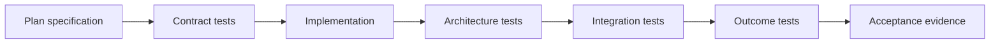

# Test-Driven Delivery and Verification

**Current policy.**

This document makes TTD a delivery requirement for Intention Relay: it defines how architecture rules become executable
checks and how implementation is judged by observable product outcomes, not only source structure or unit coverage. It
applies to every crate, vertical slice, and adapter. The mandatory pinned tooling, strict linting, the coverage policy
(per-crate tiers), Makefile targets, and supply-chain gates are defined in [Quality Gates and
Makefile](12-quality-gates-and-makefile.md).

## Delivery principle

A feature is delivered only when all three are true:

1. its typed contract is specified and tested;
2. its architecture boundaries are protected by executable checks where feasible;
3. a user-visible or operational outcome is verified through the real command/persistence path.

Compilation is necessary but never sufficient acceptance evidence.

## Required test layers

| Layer | Purpose | Examples |
| --- | --- | --- |
| DTO tests | Validate schemas, IDs, serialization, validation, versioning. | Typed DTO round trips, invalid command rejects. |
| Domain tests | Prove invariants and state transitions. | One active run, plan number monotonicity. |
| Contract tests | Prove crate-to-crate and client-to-daemon contracts. | `intention-client` command/frame fixtures. |
| Architecture tests | Prevent prohibited dependency/import/API shapes. | Adapter cannot depend on SQLite/runtime; SDK types do not escape provider crate. |
| Storage tests | Prove current-schema creation, transaction, projection, and recovery correctness. | Single-transaction state changes. |
| Runtime tests | Prove actor lifecycle, interruption, pending input, stream ordering. | Pending turn joins the live run context at the next boundary. |
| Tool/policy tests | Prove workspace addressing, execution order, Plan restrictions, and the six tool contracts. | Relative addressing from the root, one durable row per committed result. |
| Provider tests | Normalize native streams/errors and protect credentials. | OpenRouter fixture conversion. |
| Adapter integration tests | Prove Tauri bridge and TUI consume the same daemon contract. | Identical session snapshot and frames observed by both clients. |
| Outcome tests | Prove end-to-end behavior against acceptance scenarios. | Restart marks run interrupted and UI receives it. |

## Architecture rules to encode

The following are mandatory candidates for automated architecture tests:

| Rule | Required protection |
| --- | --- |
| Small-crate structure | Dependency graph check, deny cycles, and a manifest assertion for the required v1 crate set. |
| Crate accountability | A Cargo-metadata-backed check that every workspace crate is classified exactly once by its declared role and responsibility, that its named integration test targets match Cargo exactly, and that every active production crate keeps at least one. |
| Composition ownership | Only `intention-daemon` selects concrete storage/provider/tool implementations. |
| Adapter isolation | Adapter crates (`intention-tui` today; `intention-tauri` is added at M6) cannot depend directly on application runtime/storage implementations. |
| DTO-first | Public cross-crate APIs use DTOs; forbidden implementation resources/SDK types cannot escape. |
| Local protocol | Tauri bridge and TUI use `intention-client`, not direct application services. |
| Daemon authority | SQLite/runtime actor ownership appears only daemon-side. |
| Workspace boundary | File-oriented tool invocations require `WorkspaceRootDto`. |
| Extension boundaries | VFR/Headroom attach as ordinary library calls with a declared contract, not base-tool private coupling. |
| Plan integrity | Model-visible plan reads cannot expose frontmatter; ordinary Plan `write`/`edit` cannot target project paths, while Plan `execute` remains advisory-guided and audited. |
| Autopilot continuity | Plan approval pins a revision, starts a fresh same-Session Build run, and optional handoff transfers only a safe frozen context. |
| Secret safety | Secret-bearing config cannot appear in public DTO/log/error/snapshot types. |

The mandatory tooling is fixed by [12 Quality Gates and Makefile](12-quality-gates-and-makefile.md). Architecture tests
are executed through `make architecture`; the complete reproducible acceptance gate is `make verify`, `make ci` is the
local single-pass alias, while CI invokes the per-job aliases (`ci-lint-arch`, `ci-test`, `ci-coverage-default`,
`ci-deps`) as parallel matrix jobs. `make architecture` also contains isolated expected-failure fixtures for adapter
isolation, protocol isolation, composition-only concrete selection, provider-SDK public-contract leakage,
and policy-aligned workspace cycles.

## Minimum test portfolio by crate

`quality/architecture.toml` classifies every workspace crate and declares each production crate's allowed workspace
dependency edges, and `quality/coverage.toml` declares the per-crate tier floors ([Quality Gates and Makefile](12-quality-gates-and-makefile.md)).
Every production crate's test targets must exist before implementation and prove the contracts, invariants, failure
modes, and outcomes its owner architecture document states. The smallest portfolio that proves every stated invariant, contract, failure mode, and
outcome is required; no aggregate coverage number replaces it, and boundary crates prove behavior over fixture daemons
and current-schema state rather than private implementation steps.

## Result-oriented acceptance scenarios

### G. Plan-to-Build Autopilot continuity

1. Create a Plan-mode session and a physical plan revision.
2. Use `execute` for an investigation command and verify Plan policy audit.
3. Approve the exact plan revision.
4. Verify approval and fresh Build-run binding are durable and ordered.
5. Verify the same `SessionId`, a new `RunId`, pinned plan revision, and retained conversation context.
6. Verify Build Autopilot performs configured actions without per-action confirmation.
7. Verify Plan project `write/edit` remains hard-denied.

### H. Optional implementation handoff

1. Approve a plan and request a new implementation Session.
2.  Verify the target Session receives the full available safe context, plan revision, and execution prompt as a frozen
   snapshot.
3.  Verify source history is unchanged and no live runtime resource, credential, grant, or unfinished effect
   transfers.
4. Verify optional auto-start creates a fresh Build run or leaves an idle target on start failure.

The following scenarios must become executable before the corresponding capability is accepted:

### A. Shared-adapter session

1. Start a fixture daemon.
2. Connect a Tauri bridge fixture and TUI client fixture.
3. Create/open the same session through one adapter.
4. Send a user turn through the other.
5. Verify both receive the same correlated subscription snapshot and live frames.

### B. Workspace addressing

1. Create a session with a temporary workspace root.
2. Change process CWD to a different directory.
3. Invoke a filesystem tool with relative paths, and a `glob`/`grep` without an explicit path.
4.  Verify relative access resolves from the session root, `execute` observes it as CWD, and the pathless search starts
   at the root; absolute and parent paths are addressed as given, not contained
   ([architecture 05](05-tools-and-workspace.md)).

### C. Durable run interruption

1. Persist a running run and related state.
2. Restart the daemon fixture.
3. Verify no model or tool call resumes.
4. Verify an interrupted transition is persisted and visible through transport.

### D. Plan artifact integrity

1. Create a Plan-mode session/run.
2. Allocate plan `0`.
3. Edit its body through the plan path.
4. Verify frontmatter remains valid and invisible in captured model context.
5. Attempt a project-file write with normal write/edit.
6. Verify the typed denial and the durable audit record it commits.

### E. VFR and Headroom pipeline

1. Read an eligible large source fixture.
2. Verify VFR representation and expandable reference.
3. Produce eligible large tool output.
4. Verify normalized persistence, Headroom model-context compression, and `retrieve` behavior.
5. Verify adapter-visible and model-visible representations follow the agreed policy.

### F. Secret redaction

1. Use an intentionally recognizable fake credential in TOML.
2. Trigger provider config and failure paths.
3. Enumerate frames, snapshots, errors, structured logs, and adapter DTOs.
4. Verify the credential is absent from all output.

### I. Daemon-host tool loop

1. Start the real daemon binary and connect over the local protocol.
2. Send a user turn against a fake provider that emits a tool call; verify the
outgoing request advertises the six active tools (`read`, `write`, `edit`, `execute`, `glob`, `grep`) and
requests the `tool_calls` capability.
3. Verify the daemon executes the call through the real typed tool service under `WorkspaceRoot`.
4.  Verify the committed tool-call row, its answering tool-result row, and the `tool_results` row commit before
   publication, and that the client's `SessionFrameDto` notifications carry only those committed values.
5. Verify the provider exchange continues with assistant-tool-call and tool-role messages and completes.
6. Restart the daemon and re-read current state.
7. Verify the recorded tool call and result re-read from current state and are never re-executed.

### J. Live provider tool loop (opt-in, manual)

1. Set `INTENTION_REAL_API_KEY` and `INTENTION_REAL_API_MODEL`, then run
`make e2e-real-api` (which exports the `INTENTION_REAL_API_E2E=1` opt-in), or dispatch the manual
`.github/workflows/real-api-e2e.yml` workflow with its provider and model inputs. The provider kind defaults to
`generic-chat-completion-api`; `openrouter` is selectable through the optional `INTENTION_REAL_API_KIND`, and
`INTENTION_REAL_API_ENDPOINT` overrides the endpoint for self-hosted providers.
2. The `#[ignore]`d test `crates/intention-daemon/tests/real_api_e2e.rs` spawns
the real daemon binary, drives it through the real local transport, and executes a real model tool loop against the live
provider API over HTTPS.
3. Verify the provider returns a real tool call; the outgoing request
advertises the six active tools and requests the `tool_calls` capability (scenario I), the daemon executes
the call through the real typed tool service under `WorkspaceRoot`, the committed tool call and its result commit before
publication, and the run completes. When the configured model runs in thinking mode, the
continuation request also carries the same round's accepted reasoning as `reasoning_content` on the assistant tool-call
message; no prior-turn reasoning is transferred.
4. Restart the daemon and re-read the run; verify the recorded tool call and
result re-read from current state and are never re-executed.
5. Verify the credential is absent from the committed transcript rows, session snapshots, daemon logs,
and state bytes.
6. Verify an invalid credential produces a typed failure mapping and never an
untyped panic or a credential echo.

This scenario is non-hermetic: it needs network access, a live provider, and a real credential. It runs only under the
explicit opt-in ([Quality Gates and Makefile](12-quality-gates-and-makefile.md)) and never in `make quick`,
`make verify`, CI, or any required status check.

## Verification evidence

Each completed slice reports the architecture document, acceptance criteria, and tests it implements; the `make quick`,
narrow, and `make verify` checks it ran; the outcome scenarios it covers; and every lint, coverage, feature,
dependency, or architecture exception with its recorded rationale. Deliberately deferred behavior is recorded as an
explicit open decision, never as omitted coverage. The 2026 corrective pass consolidates every fact it leaves open in
the [Implementation Roadmap](11-implementation-roadmap.md)'s open-decisions record, each with its owner, its anchor, and
its re-audit status. A cited live run reports its date, commit, provider, model, and
workflow run URL and never the credential; the opt-in live channel is additional evidence only and never a substitute
for the mandatory hermetic gates ([Quality Gates and Makefile](12-quality-gates-and-makefile.md)).

### Slice 1.5 evidence

Slice 1.5 replaces the event, snapshot, and replay contract blocks with current-state storage tests: schema tests
create the current-state tables directly on open, and transaction tests prove one SQLite transaction per state change
with publication from the committed values. The daemon end-to-end tests drive the real asynchronous `intention-client`
instead of the low-level transport. Tool-call tests cover one transaction per call, the pre-effect identity rejection,
and the durable terminal row. Protocol contract fixtures cover the reduced
current-state surface with no resync, cursor, or event DTOs. Tests of deleted surfaces are deleted without replacement,
and the per-crate coverage tiers in `quality/coverage.toml` are unchanged.

### Slice 2 evidence

Slice 2 delivers the terminal application as one `intention-tui` binary over the shared client, and its evidence follows
the same contract-first shape. Protocol and storage contract tests cover the new `ListSessions` request and
`SessionsListed` result: recency order, the bounded session window, and the `omitted` count instead of a silent
truncation. Protocol contract tests cover the transient `TextDelta` frame, its channel discriminator, and the rejection of
empty text on the wire. Engine
tests prove the `ModelTextDeltaPort` observes every provider text chunk with its model-step index and channel — the
answer channel and the reasoning channel the same step thinks with — persists nothing,
and leaves run behavior unchanged when unattached. Client tests prove `list_sessions` and the `SessionStreamState`
buffers, one per channel: a delta for a new step replaces the previous step's buffer, and a committed assistant row or a
fresh subscription clears both. Daemon tests prove `ListSessions` dispatch, per-channel delta coalescing, the order of the
two channels, and that the step's pending deltas flush before its committed frames.

The presentation-only theme surface carries its own contract evidence. Protocol contract tests cover the
`GetTuiSettings`/`SetTuiTheme` request and result pair and the `ThemeDto`, `TuiSettingsDto`, and `TuiThemeAcceptedDto`
durable spellings, with an undeclared or absent theme spelling rejected in either direction. Configuration contract
tests cover the absent, `light`, and `dark` `[tui]` sections and the typed `invalid_tui_theme` rejection of an unknown
spelling. Storage contract tests cover the single-row `tui_settings` override, its absent read, its reopen, the fact
that a theme set records no configuration revision, and the schema stamp 3 the new table carries, with a database from
the previous stamp discarded and recreated. Client tests validate a settings reply and reject an acceptance that names
another theme. Daemon tests prove the effective-theme rule (the stored override, else the resolved configuration, else
light) and that a stored theme survives a daemon restart.

The terminal crate itself carries a render suite and a process end-to-end suite. `tests/tui_render.rs` renders the
render-free `AppState` through revue's own test app in eighty-one cases: the welcome surface (the lockup and the
overview, gone once a session opens, the launch that lists sessions but opens none, and the state that never covers a
reported row), the chat panel, the transcript blocks (the
labelled user card and the markdown inside it, the markdown answer, the heading (its text painted without the parser's
`#` marker), the bold phrase, the aligned table,
the committed reasoning block with its collapsed marker and its chunked expansion, the reasoning-only row that draws no
answer line, the reasoning painted above the tool exchange it precedes, the blank gap row, the streaming
tail laid out row for row like the committed answer block it becomes, the live reasoning segment laid out like the
committed reasoning block it becomes, the framed tool blocks for `read`, `glob`, `grep`, `write`, `edit`, `execute`, and an unknown
`tool_id`, the call-without-result degradation, and the notice blocks streamed live and restored by a snapshot), the
input line and its badges, the command hint band (its own frame and title, the three columns, a narrowed filter,
a moved highlight, a slash that is not the first character opening nothing, and a window too short for the band
keeping the input's rows), the argument band (a declared argument's two values in the same three cells with the
argument's name in the trailing column), the theme picker panel (its `Theme` title, one row per theme with the theme's
description, the committed row's `> ` marker moving to the previewed row, its `enter apply | esc revert` legend, and a
window too short for the panel keeping the input's rows), the same chat and welcome screens painted under both themes,
a two-line buffer growing the input block and shrinking the transcript, the armed `Esc`
clear and the `Ctrl+C` clear, exit, and stop notices, the stop the daemon's accepted reply confirms, the stop a
lost subscription refuses to send, and the run whose stream died ending its own liveness, the human status row,
transcript scrolling, and the docked
sessions panel (its frame and embedded title, the tab radio row, the search bar, the table header, columns, cursor
marker, and resize reflow, the footer legend and row counter, and the stub tabs' `@todo` empty state).
`tests/terminal_e2e.rs` spawns the
real binary against a real daemon and the scripted fake provider in fifteen cases: NDJSON transient deltas before the
committed row, the channel-tagged reasoning deltas that precede the answer they inform, progressive text output and
completion, both REPL paths (a piped turn and input EOF), the prompt that creates the session it needs, an explicit
continuation that reuses its session instead of creating one, every `/new` run creating a fresh session under one
workspace root, a multi-line prompt reaching the session unchanged, a slash-prefixed prompt reaching the session as one
turn instead of running a command, a prompt ending in a backslash reaching the session unchanged, the timeout deadline
stop that ends the process with the interrupted status, a SIGINT that stops the headless run's stalled round and ends
the process with the interrupted status, a SIGINT that stops the REPL's stalled round and hands the loop back to its
prompt, and a typed unknown-session rejection with exit 3. The binary's own unit tests cover the command
grammar, the exit-status mapping, the workspace-root resolution, the REPL line loop, and the headless formats, drivers,
and wait deadlines, including the reasoning-only row the text report leaves unwritten. The crate's inline unit tests cover the `AppState` transitions, the settings load and theme
selection and rejection paths, the picker's preview, commit, and revert transitions, the theme vocabulary and its
parser, the command registry with its declared arguments and a submitted line's argument resolution and notices, the
ranking and menu
transitions, the one-press rule that runs a word already spelling its command or value, the hint band's row arithmetic
and columns, the keymap, both themes' palette roles and the documented
opacity, distinctness, `error`/`scarlet` alias, cross-theme, and dark-monochrome rules, the
wheel mapping, the left-button pointer's press, drag, release, marker expansion, and edge scrolling, the turn clock, the
browser geometry and row helpers, the markdown layout and the heading marker it drops, the per-tool block dispatch, the marker and notice layout, the
reasoning-only row that owns one block with no answer line and the reasoning place above the tool exchange it precedes, the
transcript layout cache's append-only fast path, width change, theme change, replacement, reasoning expansion,
paired-result, and
front-trim replays, and the clipboard-free source audit. A run of
`cargo nextest run -p intention-tui` observed 375 tests across four binaries, all passing: 251 library unit tests,
81 `tui_render` cases, 30 binary unit tests, and 13 `terminal_e2e` cases. A run of `cargo nextest run --workspace`
observed 783 tests run, 783 passed, and 2 skipped.

The per-crate self-checks are `cargo fmt -p intention-tui`, `cargo nextest run -p intention-tui`, and
`cargo clippy -p intention-tui --all-targets`; the slice's acceptance gate is `make quick` during delivery and
`make verify` before merge. Tests of deleted surfaces are deleted without replacement, the crate keeps its declared
`edge` tier, and the per-crate coverage policy in `quality/coverage.toml` is otherwise unchanged.

### Slice 2 tool-execution corrections

The retrospective tool-execution corrections land inside the activated slice. `execute` now takes one
`ShellCommandTextDto` and optional typed `cwd`, `env`, and `timeout_seconds` parameters and runs through the private
platform shell adapter — `bash -c` on Unix and `cmd /C` on Windows — so pipelines, redirects, and compound commands
are ordinary tool semantics. The fixed thirty-second ceiling is removed: a call without a declared timeout has no
deadline, and `READER_DRAIN_GRACE` is the one liveness bound, applied as a fixed pipe-collection window after the
direct child is reaped. Tool-contract tests cover the pipeline, redirect, and compound-command semantics, a declared
working directory and environment overlay, the declared timeout's own interruption cause (`InterruptCause::TimedOut`)
with the notice that names the declared value, and the background descendant that cannot extend the collection. A
pathless `grep` searches from the workspace root, matching architectures 05 and 15.

A call cut by its own declared deadline is a `Partial` result, never a lost one: the tool names the deadline in the
model-visible notice and commits `interruption=tool_timed_out` beside `declared_timeout_seconds` in the durable
evidence, while a caller stop observed at the same moment stays the stop and the post-reap collection window keeps
lost evidence. Engine tests drive a real `execute {"command":"sleep 5","timeout_seconds":1}` through the tool service
and assert the cause, the notice, and both metadata entries; the storage contract proves those entries survive a
reopen; the daemon end-to-end suite proves the real daemon answers the timed-out call with that notice and completes
the run.

Tool failures are now recoverable. The daemon's tool seam and the engine's durable local-tool lifecycle commit one
call row plus exactly one terminal result per model call; a call whose arguments do not decode, an unknown tool name,
and any workspace or execution failure commit a `Failed` result whose content is the bounded guidance rendered by
`tool_failure_guidance`, and the model loop answers the call with that content and continues. `m3_engine` proves the
decode failure and the unknown tool each commit the call row and one guided result; `m5_tool_loop` proves the failed
call is answered with its guidance, executes exactly once, and is never retried; the daemon end-to-end suite proves
the real daemon completes the run, delivers the guidance-bearing tool row, and asks the fake provider exactly once
more. The terminal adapter reads the call's `command` and declared `cwd` for its execute facts. A run of
`cargo nextest run --workspace` observed 783 tests run, 783 passed, and 2 skipped; the acceptance gate is `make quick`
during delivery and `make verify` before merge.

### Slice 2 step-reasoning correction

The same slice's reasoning gap is closed in the core. Protocol contract tests admit an `Assistant` row that carries text
or reasoning, so a reasoning-only step is a coherent row while a row with neither stays `invalid_message`. Engine tests
prove the rule the transcript depends on: every completed step commits one assistant row whenever it produced text or
reasoning, that row commits before the step's own tool rows, a reasoning-only final step commits its reasoning alone,
and an interrupted reasoning-only step commits its reasoning without the `[interrupted]` marker. Storage tests prove a
reasoning-only row round-trips through the transcript read and that the model-context rebuild skips it, so reasoning
never replays into a later request. Client tests prove a committed reasoning-only content frame clears the provisional
reasoning buffer. The daemon end-to-end suite drives a real daemon over the scripted fake provider with round reasoning
and pins both the live stream order and the committed order — `assistant(reasoning)` before `tool_call`, `tool_result`,
and the answering `assistant` row. The terminal render suite proves a reasoning-only row draws its reasoning block
alone with no `∷` answer line, that a reasoned tool round paints its reasoning above the exchange it precedes, and that
the headless text report writes no assistant line for a reasoning-only row.

### Slice 2 run stop and live-run liveness

A run can now be stopped for good, and no front end can be trapped by a run it cannot reach. Protocol contract tests
carry `CancelRunCommandDto`, `ClientRequestDto::CancelRun`, `RunCancelledAcceptedDto`, and
`ProtocolResultDto::RunCancelled` over the closed request and result vocabularies, so the wire has one terminal stop
beside the interrupt that keeps a run alive. The engine owns the stop itself: `RunCancellation` carries it, five
execution boundaries honour it — the loop top, a finished step, an interrupted step, the failed arm, and the boundary
after a tool batch — and the honoured stop commits `[The run was stopped before a final answer.]` before
`finish_run(Interrupted)`. `m5_tool_loop` proves a stop that arrives while the round select waits ends the run with one
provider execution, one terminal commit, and the stop notice alone, and a stop the tool port raises while it answers
its first call keeps that committed result and ends the run at the batch boundary instead of asking the model again.
The daemon's end-to-end suite drives a real `execute {"command":"sleep 10"}` through the real daemon and stops it
mid-flight: the run finishes `interrupted`, the tool result is the bounded partial with its stopped notice, the fake
provider is asked exactly once, and the session's next turn is accepted. A stop whose run has no registered execution
is terminalized durably `interrupted` the way recovery writes it, so the request never silently does nothing.

The terminal front ends select SIGINT instead of dying from it. `AppState::live_run` is the one liveness rule — a live
subscription and a non-terminal status — and the stream-loss handlers clear the phase and the tool watch, so a daemon
that died ends the run's liveness instead of holding the front end's stop, clear, and exit arms. `Esc` stops a live run
in one press, `Ctrl+C` arms the stop and fires it on the second, and the line front ends wire the same request to a
SIGINT receiver every wait selects on: the REPL stops the live run and returns to its prompt (a signal at the prompt
leaves the loop like `/quit`), and `run <PROMPT>` reports the interrupted outcome with status 5. Inline unit tests cover
the stop request and its notice, the stop a live subscription refuses to send, the accepted and failed stop reports, and
the liveness the stream-loss handlers end. `tests/terminal_e2e.rs` proves both process contracts against a real daemon
with a stalled provider: the SIGINT stops the round, the process ends with the interrupted status, the stop notice and
the terminal run status are durable, and the REPL prompt comes back for the next line. A run of
`cargo nextest run -p intention-tui` observed 375 tests across four binaries, all passing, and
`cargo nextest run --workspace` observed 783 tests run, 783 passed, and 2 skipped; the acceptance gate is `make quick`
during delivery and `make verify` before merge.

### Slice 2 live-session-stream correction

The reported defect — two terminal windows on one session, a turn sent in one producing nothing in the other — is closed
as a core correction rather than a terminal workaround: the run-scoped subscription is replaced by one live channel per
session, and every committed row of that session is published to it. Protocol contract tests carry
`SubscribeSessionCommandDto`, `ClientRequestDto::SubscribeSession`, `ProtocolResultDto::SessionSubscribed`, and
`SessionFrameDto` with `content`, `status`, and `text_delta` decode, and the closed result-kind set swaps
`run_subscribed` for `session_subscribed` without a compatibility path. Client tests prove the session scope: the
subscription snapshot is an ordinary `SessionSnapshotDto`, a content frame of another run of the same session applies,
another session's frame is rejected without mutation, a delta reaches only the projected run, and the newest-row dedupe
and transcript bound survive. Engine tests prove the turn path hands the committed user row and the `Starting` status to
the one commit observer exactly once, and that a queued turn publishes its acceptance alone. Daemon tests prove the
subscription registry is keyed by session: two subscribers on one session both receive the accepted user row, the run's
status transitions, the assistant row, the step's transient deltas, and the terminal status; a subscriber of another
session receives nothing; an unknown session is refused with `storage_record_not_found` and is never registered; queue
overflow closes one subscriber only. The client-driven end-to-end suite proves the reported scenario itself: client A
subscribes to the session, client B sends a turn over a second connection, A observes the row, the status frames, the
answer, and the terminal status, and a stop from A publishes its notice and terminal status to B. In the terminal crate,
`AppState` tests prove opening a session always asks for its session stream, an accepted turn on a live stream asks for
nothing, a run another window started becomes the projected run with its own phase and is stoppable from this window, a
row another window committed joins the transcript, a cross-session frame is still a scope failure, a lost stream clears
the phase and tool watch and asks for exactly one reconnect, and the stop, clear, and exit arms stay reachable after a
failed stream. A run of `cargo nextest run -p intention-tui` observed 379 tests across four binaries, all passing: 255
library unit tests, 81 `tui_render` cases, 30 binary unit tests, and 13 `terminal_e2e` cases. A run of
`cargo nextest run --workspace` observed 790 tests run, 790 passed, and 2 skipped; the per-crate suites observed
`intention-proto` 38, `intention-client` 26, `intention-engine` 80, and `intention-daemon` 42 (2 skipped). The acceptance
gate is `make quick` during delivery and `make verify` before merge.

### Future package evidence

Evidence obligations for systems that are not activated are owned by their documents; this document keeps only the
pointers:

- Slice 1.5 core simplification — [Implementation Roadmap](11-implementation-roadmap.md).
- Tool registry and model-tool loop — [architecture 15](15-tool-registry-and-model-tool-loop.md).
- MCP capability lifecycle — [architecture 18](18-mcp-capability-lifecycle.md).
- Gateway/RLM bridge — [architecture 19](19-gateway-rlm-bridge.md).
- IPython kernel lifecycle — [architecture 20](20-ipython-kernel-lifecycle.md).
- Goals, skills, context, memory, and compaction — [architecture 21](21-goals-skills-context-memory-and-compaction.md).
- Provider evolution, profiles, and reasoning — [architecture 22](22-provider-evolution-profiles-and-reasoning.md).
- Session branching and regeneration — [architecture 23](23-non-destructive-session-branching-and-regeneration.md).
- Daemon, transport, and adapter boundary — [architecture 03](03-daemon-transport-and-adapters.md).
- Configuration and provider control plane — [architecture 25](25-configuration-provider-control-plane.md) (protocol:
  [architecture 29](29-provider-session-and-profiles-protocol.md)).
- Post-M4 evidence obligations — activating specification per [architecture 12](12-quality-gates-and-makefile.md).

## Non-goals

No specific Rust test framework is mandated, and no test count or coverage percentage replaces reviewer judgment.
Snapshots are not a substitute for semantic assertions, and a unit test reaching a private method never proves that a
user flow works.
