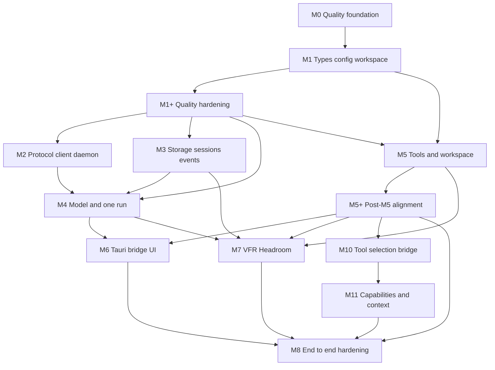

# Implementation Roadmap

## Scope

This is a dependency-aware delivery roadmap, not a time estimate. The first implementation milestone is the reproducible
quality foundation. Every later milestone begins with failing tests and is accepted only after its applicable `make
verify` evidence passes. This roadmap owns milestone order, dependencies, activation, and status only: required quality
commands, pinned tools, the coverage policy, the lint policy, and supply-chain gates live in [Quality Gates and
Makefile](12-quality-gates-and-makefile.md); test-first and outcome-verification rules live in [Test-Driven Delivery and
Verification](10-test-driven-delivery-and-verification.md).

The systems of documents 15 and 18-30 and of Slices 3-6 are not activated, and each activation requires an accepted
activating specification ([Quality Gates and Makefile](12-quality-gates-and-makefile.md)). Slice 2 is closed.

## Closed milestones (M0-M5)

M0-M5 are closed, and the architecture documents describe their delivered behavior. The sections below record the
remaining plan.

## Dependency graph

## Quality rule for every milestone

Every milestone after Milestone 0 follows the test-first rules of [Test-Driven Delivery and
Verification](10-test-driven-delivery-and-verification.md) and the quality policy of [Quality Gates and
Makefile](12-quality-gates-and-makefile.md): new production crates meet the line floor declared for them before merge,
new optional Cargo features extend the single feature
configuration in the same change, only pinned dependencies and tools are used, `make quick` runs during
development and `make verify` before acceptance, and any policy exception is recorded in a reviewed, versioned policy
file with rationale and equivalent test evidence.

The coverage policy is the per-crate line floors in the root `Makefile`'s `COVERAGE_FLOORS`
([Quality Gates and Makefile](12-quality-gates-and-makefile.md)).

## Milestone 5+: Post-M5 retrospective alignment

**Activation home for the complete post-M5 stack; hard prerequisite for M6-M8 and M10-M11.** Slice 3 absorbs the
former M7 milestone — except the optional implementation handoff, delivered by Slice 6 — and the `sub_agent` tool
path of the former M11; the remaining milestones renumber in sequence, so the former M8 is M7, the former M9 is M8, the
former M11 is M10, and the former M12 is M11. This milestone is the declared prerequisite of
the remaining milestones in the dependency graph. It activates only foundation work, including the terminal
presentation foundation, and defines the Slice 3 agent-operation scope without activating it; neither is a direct
boundary implementation. The remaining post-M4
package implementations are not part of its slices: they are delivered by Milestones 10 and 11, which consume this
milestone's foundation. The activation decision is the Milestone 5+ package, extended by [architecture
30](30-instruction-sources-and-system-context.md) for the third slice's instruction channel, [architecture
07](07-plan-and-build-modes.md) for its Plan/Build modes and physical plans, and [architecture
15](15-tool-registry-and-model-tool-loop.md) for its `sub_agent` tool contract.

### Slices

The seven slices are sections of one activating specification accepted for this milestone, and later slices consume only
contracts activated by earlier slices. Every direction stays bound to its slice, and every retrospective change to
M0-M5 code required by those directions activates inside its slice with its own contract, transaction, and outcome
test.

-  **Slice 1 — Contracts and versions — activated.** The typed serde JSON contract and version foundation; SQLite as
one live storage schema created directly on open ([architecture 00](00-principles-and-scope.md)); and crate ownership
and coverage declarations under [Quality Gates and Makefile](12-quality-gates-and-makefile.md) for every activated
family. Every contract family is typed serde JSON with RFC 8785 canonicalization
only when a first real consumer appears.
-  **Slice 1.5 — Core simplification — activated.** The workspace is nine production crates with the current-state
storage core: the six current-state tables (`projects`, `workspace_roots`, `sessions`, `runs`, `turns`, `messages`),
each started run's frozen `ConfigSnapshotDto` on its run row (`config_snapshot_json`), the transcript as `messages`
rows, one durable tool-result message row per completed call, plain-index model steps and tool groups,
per-transaction state changes with session frames built from the committed values, the fixed-literal endpoint
(`intention-relay`) with fail-closed typed decode as the only protection against a foreign peer
(`invalid_local_protocol_response`), re-subscription receiving the current session state and its bounded recent
messages, one asynchronous client without a blocking API, one direct tool-cycle sequence, the daemon host calling the
engine directly, and one integer-stamped live schema where a stamp bump discards and recreates the database with no
migration or compatibility path.
-  **Slice 2 — Terminal UX — closed.** One `intention-tui` binary with three contract-equivalent modes — the
full-screen TUI, the mandatory interactive REPL, and the headless command — over one `intention-client` surface, with
the closed typed exit-status set and no presentation logic in the daemon; owned by
[architecture 03](03-daemon-transport-and-adapters.md). Closing a slice changes no crate classification, so the crate
map and the coverage floors move together only when Slice 3 adds its own crates.
-  **Slice 3 — Agent operation — not activated.** The instruction channel of
[architecture 30](30-instruction-sources-and-system-context.md): the code-owned base instruction text, one
user-authored fragment list edited at the filesystem level, workspace `AGENTS.md` project instructions read through the
`WorkspaceRoot` anchor, and the
reserved `Mode` and `Vfr` contributions owned by architectures 07 and 06; deterministic assembly and the frozen
instruction text, delivered through the
existing `system_context` channel, and materialized into fork, plan, and handoff records; closed safe failures,
channel closure, and safe observability. The slice also carries the Plan/Build half of
[architecture 07](07-plan-and-build-modes.md): the Plan/Build run policy, with Build Autopilot as the single
user-authorized unrestricted Build policy; body-only plan artifacts in the daemon-defined global plans directory,
named by the model's requested file name (`plan_name_conflict` on a taken name), with zero-based per-session numbers
and committed revisions tracked in SQLite; the `drafting | approved | abandoned` lifecycle, where approval pins one
exact revision and, by default, immediately starts a fresh same-Session Build Autopilot run with a new `RunId`;
ordinary project `write`/`edit` denied in Plan mode while `execute` stays available, advisory-guided, and audited, its
focus instruction being the `Mode` contribution this same slice assembles; and the `intention-plans` crate with the
`plan_submit` ToolId variant, its own spec, and its typed input carrying the requested file name. The optional implementation handoff to a new
Session stays Slice 6 work. The slice also carries the `sub_agent` tool path of
[architecture 15](15-tool-registry-and-model-tool-loop.md): the closed `ToolId` variant whose typed input carries the
bounded markdown task and the selected mode; `Sync` holds the call open until the child run's terminal markdown answer,
and `Async` ends it immediately with a `Completed` result carrying the child session handle; a child run is an ordinary
run with its own lifecycle, tool loop, cancellation, and no-resume rules, and its terminal answer commits as one durable
child-result fact bound to the same `ToolCallId` and delivered once into the parent's next fresh model request. The
`sub_agent` tool activates on the live six-tool admission path and activates no registry, bridge, or MCP contract: the
frozen tool selection, tool admission, and Gateway/RLM bridge stay with Milestone 10. Its activating specification
declares the instruction-channel contracts as typed serde JSON contracts, activates the `sub_agent` tool contract and
the Plan/Build policy on the live tool path, and changes no earlier slice.
-  **Slice 4 — Provider configuration and typed configuration editing — not activated.** Discovery (architecture 25),
the typed configuration-editing surface (architecture 25), and the session-selection layer (architectures 29/22): the
named provider-entry list with its global default, the session selection command and query, the bounded provider list,
the typed editing surface, discovery as an ordinary non-authorizing read, and the optional named authentication header,
with the entries built at startup. Controlled live reload, in-process credential rotation, provider health checks,
pricing and budget policy, raw-TOML editing, per-turn and fork provider overrides, opaque catalog pagination, catalog
tombstones, user-declared kinds, and the typed cross-run reasoning-transfer surface are outside the slice
(architectures 22, 25, 29).
-  **Slice 5 — Goal domain — not activated.** The Goal domain (architecture 28). The slice also activates the
tool-descriptor, tool-registry, and model-tool-loop contracts as amended under [architecture
15](15-tool-registry-and-model-tool-loop.md), the bridge invocation and MCP connection-record contracts (architectures
19/18), and work/requeue after client disconnection.
-  **Slice 6 — UI foundation — last slice; not activated.** Session branching and regeneration, reasoning/catalog
delivery, and adapter boundaries (architectures 23/22 plus architecture 03's flat activity journal and notification
list): the fork, preview, branch-level, rename, archive, and restore DTOs plus the ordinary same-session regeneration
run start bound to the parent `RunId` it regenerates; normalized reasoning delivery; and the exact typed
client/protocol surface M6 consumes. It also carries
the optional implementation handoff after plan approval, which creates an independent Session from a frozen safe
context, materializes the frozen instruction text into its frozen records, and may start a fresh Build Autopilot run
(architecture 23);
cross-workspace clone/rebind (architecture 23); and the physical deletion/GC retention policy for historical work under
architecture 04's retention rules.

### Exit criteria

-  Every remaining milestone (M6, M7, M8, M10, and M11) has an accepted activating specification before its
implementation starts.
-  Slice 1.5 preserves durable meaning: the single storage schema is created on open under one integer stamp, where a
stamp bump discards and recreates the database with no migration or compatibility layer, and tool and lifecycle
semantics keep their recorded law.
-  The Slice 2 terminal keeps one `intention-tui` binary whose three modes stay contract-equivalent over one
`intention-client` surface, exit with the closed typed status set, and carry no presentation logic into the daemon.
-  The Slice 4 discovery and typed configuration-editing surfaces are non-authorizing: they create no RunId, tool
permission, kernel epoch, context projection, or branch, and the activating
specification must prove that non-authority.
-  Applicable crates meet their declared line floors without excluding policy or boundary logic.
-  Every activated contract ships with its version, owner, tests, policy mapping, storage/schema treatment, and
evidence.
-  No remaining-milestone boundary behavior is implemented, and no second runtime, registry, persistence authority, or
sandbox is introduced.
-  The third slice proves instruction text is advisory-only and materialized for frozen context, that Plan-mode
mutation denial is enforced and audited while Plan `execute` stays advisory-guided, and that a `sub_agent` child run
stays an ordinary run, with no untrusted material entering the instruction channel and no authority created
([architecture 30](30-instruction-sources-and-system-context.md), [architecture 07](07-plan-and-build-modes.md)).
-  Milestones 10 and 11 are this milestone's successors for the remaining post-M4 packages; their activating
specifications, contracts, and evidence stay owned by those milestones. M7 consumes only the declared `Vfr`
contribution, the third slice consumes the declared `Mode` contribution, and M11 keeps the Skill and
context-selection boundary.

### Failure semantics

- Each slice fails closed before effect when its contract is unsupported or inconsistent; no partial contract or partial
  projection is delivered.
- Recovery never resumes, retries, reattaches, or reruns work under any slice.

### Known deferrals

Facts this milestone leaves open are recorded here as known deferrals, each with its owner when one exists
([architecture 10](10-test-driven-delivery-and-verification.md)).

| Deferred fact | Owner |
| --- | --- |
| the execute-call fact on the session summary | no owner yet |
| a durable session title and its rename command (the title column and its filter) | M5+ Slice 6, via [architecture 23](23-non-destructive-session-branching-and-regeneration.md) (not activated) |
| a durable favorite flag | no owner yet |
| a durable archive flag and its command | M5+ Slice 6, via [architecture 23](23-non-destructive-session-branching-and-regeneration.md) (not activated) |
| a session list paged past its bounded window (the row counter's `+N omitted`) | no owner yet |
| a notice code or severity (a notice block's text-only body) | no owner yet |
| durable committed-row identity for streamed text (the durable `messages.step`/`MessageProjectionDto.step` alternative to the client-derived supersession) | no owner yet |
| the run-captured provider model, the model that served each run (the alternative to the session projection's effective model) | no owner yet |
| live per-round usage (the alternative to publishing usage with the committed terminal outcome) | no owner yet |
| the in-UI rendering of a launch failure, a launch-failure `--continue` shown in the running front end instead of exiting 3 | no owner yet |
| the sessionless `--continue` launch, the alternative to the typed `no_sessions_to_continue` failure and exit 3 | no owner yet |

## Milestone 6: Tauri bridge and primary desktop UI

Goal: the first desktop adapters over the shared typed client, consuming the Milestone 5+ UI-foundation and
agent-operation slices.

### Deliver

- the new `intention-tauri` crate (created in this milestone) provides the bootstrap/native bridge using only
`intention-client`;
-  minimal Svelte UI to create/open a session, send a turn, render streamed state, reconnect, and render the safe
activity-journal and notification projections;
- TUI/REPL remains a contract-equivalent client;
-  post-M4 activity-journal and notification contracts are delivered by the Milestone 5+ UI-foundation slice and
consumed here.

### Tests first

- bridge contract tests using a fixture daemon;
- TUI/bridge equivalent command, query, and frame tests;
- desktop lifecycle smoke test where the environment supports it;
- adapter mapping coverage and fixture-daemon outcome scenarios.

### Exit criteria

- Tauri and TUI can observe the same daemon-owned session; closing Tauri does not stop daemon-owned work;
- no Tauri crate imports application/runtime/storage implementation APIs;
- adapters satisfy mapping-contract and smoke/outcome requirements rather than a misleading aggregate UI line target.

## Milestone 7: VFR and Headroom modules

Goal: independently enabled transforms over the base tool pipeline, delivered as modules of `intention-tools`.

### Deliver

-  The VFR module: mapping, expansion/raw tools (`expand` and the raw-read path as future `ToolId` variants), and model
instructions as the `Vfr` contribution of [architecture 30](30-instruction-sources-and-system-context.md);
- The Headroom module: the CCR read-through contract over the durable tool result and the retrieve tool;
- deterministic composition with the workspace/tool pipeline;
- adapter/model representation policy;
- the deferred VFR language set and size thresholds recorded as `@todo(vfr)` markers in the module until an activating
specification selects the values.

### Tests first

- VFR transform/expand/raw fixtures;
- Headroom retrieval and missing-reference fixtures;
- full pipeline-order integration test;
- UI/model representation distinction test;
-  coverage fixtures for transform, retrieval, and error paths under the `intention-tools` line floor
([Quality Gates and Makefile](12-quality-gates-and-makefile.md)).

### Exit criteria

-  VFR and Headroom operate as independently enabled modules; `retrieve` returns the durable tool result its reference
names and reports a typed missing outcome otherwise;
- base tools stay free of transform behavior, and no separate extension crate exists;
-  The modules meet `intention-tools`' declared line floor ([Quality Gates and Makefile](12-quality-gates-and-makefile.md)).

## Milestone 8: Hardening and acceptance verification

**Final hardening gate for every milestone in this roadmap, including Milestones 10 and 11.** It closes the v1 outcome
scenarios and the documentation reconciliation for every delivered milestone; the speculative hardening decisions are
explicit v1 non-goals below.

### Deliver

-  final architecture checks; observability, health, and safe structured diagnostics; frozen config-snapshot behavior
and redaction hardening; the restart/reconnect/cancellation smoke suite;
-  documentation reconciliation against implemented public contracts, including ownership of the architecture index and
its owner paragraphs (`architecture/README.md`);
- the post-M4 evidence obligations of architecture 10 for the remaining post-M4 packages; and
-  the removal-program evidence anchor for the single-version policy across every versioned system
([architecture 00](00-principles-and-scope.md)).

### v1 non-goals

These speculative decisions are explicit v1 non-goals, not deferred work:

- daemon-upgrade coordination: no live upgrade path; the daemon is stopped and restarted;
- stale-listener recovery: the listener ownership safeguards stay; no recovery policy beyond them;
- idle shutdown: a daemon runs until it is stopped;
- TOML include or import: configuration is exactly one TOML document;
- non-Unix configuration permissions: v1 defines no configuration file-permission policy;
- diagnostic export and retention: logs stay operational diagnostics; no export or retention policy exists;
- decode-time DTO validation enforcement: DTOs stay validated at admission; no decode-time enforcement beyond field
types.

### Tests first

-  the full result-oriented scenario suite from [Test-Driven Delivery and
Verification](10-test-driven-delivery-and-verification.md);
- the real-binary daemon-host model-tool-loop outcome test; the broader M8 scenario suite remains;
-  a recorded opt-in live-provider e2e run against a real provider API
([Quality Gates and Makefile](12-quality-gates-and-makefile.md); manual, non-hermetic, never blocking) reporting date,
commit,
provider, model, and the command and machine it ran on;
- secret injection regression suite;
- daemon restart and reconnect endurance fixtures;
- architecture dependency/API boundary checks across all crates;
- a complete `make verify` reproducibility check from a clean, pinned-tool environment.

### Exit criteria

-  all v1 outcome scenarios are automated where practical and recorded where manual environment testing remains
necessary;
- no unapproved architectural, lint, coverage, feature, or dependency exception remains implicit;
-  every public DTO and crate boundary agrees with the architecture documentation or the documentation is updated in the
same change;
-  every milestone, M0-M5 (in repository history) and M6-M8 and Milestones 10-11 (as recorded artifacts), records its
acceptance evidence, and the `make ci` run covers them;
- `make ci` passes from a clean environment using only pinned inputs.

## Milestone 10: Tool selection, admission, and Gateway/RLM bridge

**Depends on Milestone 5+ as foundation.** The model-tool loop itself is live since Milestone 5 and Slice 1.5: this
milestone consumes it and never redefines it. It delivers the remaining [architecture
15](15-tool-registry-and-model-tool-loop.md) contracts — the frozen tool selection and tool admission over the live
six-tool layer — the Gateway/RLM bridge packages (architecture 19), and the worker/process supervision topology
direction. It starts only when an activating specification per [architecture
12](12-quality-gates-and-makefile.md) is accepted.

### Deliver

-  the frozen tool selection and tool admission over the live six-tool `ToolId` set and its code-owned spec match, where
a new tool id stays a new `ToolId` variant with its own spec (architecture 15);
-  the spawned kernel child's typed-client ingress into the one-path selection admission and tool-loop facts
(including the already-delivered `sub_agent` ingress), re-subscription reading current state, cancellation
propagation, recovery, and the closed `bridge_*` failures (architecture 19);
-  worker/process supervision topology, never a second runtime, registry, persistence authority, or sandbox (architecture 03);
-  crate ownership and coverage declarations under [Quality Gates and
Makefile](12-quality-gates-and-makefile.md), plus quality-policy declarations for every activated family.

### Tests first

- frozen-selection and tool-admission fixtures, plus the ordered-group shape matrix and effect-evidence fault injection
over the live loop;
- kernel-child ingress, re-subscription reading current state, cancellation, slow-peer, and no-bypass fixtures;
- supervision-topology fixtures;
- tool-denial and ordinary workspace-addressing fixtures.

### Acceptance outcomes

-  every tool call travels the frozen selection and admission path and produces durable evidence exactly once, with no
retry of an interrupted call;
-  bridge ingress cannot bypass selection admission, `ToolCallId`, start/result evidence, or post-commit reread
publication;
- no ordinary tool path, denial, or re-subscription read changes meaning.

### Exit criteria

-  the activating specification's contracts, tests, coverage, and evidence are recorded;
-  no two capability paths or registries exist, and supervision is topology only, never a second runtime or sandbox;
- the milestone's activation evidence is recorded.

## Milestone 11: Capabilities and context — MCP, kernel, and Skills/context

**Depends on Milestone 10.** It delivers the post-M4 MCP, kernel, and context packages (architectures 18/20/21), the
project script library of [architecture
20](20-ipython-kernel-lifecycle.md), and the architecture 22 provider work that remains
not activated: the `responses` driver. It starts only when an activating specification per [architecture
12](12-quality-gates-and-makefile.md) is accepted; that activating change also declares the kernel contract families as
typed serde JSON contracts ([architecture 02](02-dto-and-contract-policy.md)).

### Deliver

-  MCP connection records with discovery and bounded per-connection method lists, direct invocation under the fixed
`mcp` ToolId, private resources, single-commit call binding, safe projection, disposal, and no-resume recovery
(architecture 18);
-  session-scoped private kernels with run-scoped namespaces, foreground cells, safe output, verified checkpoints,
background-task restrictions, cancellation, recovery, and no-resume semantics (architecture 20);
-  the project script library (`.ir/scripts`): agent-authored modules persisted as ordinary project files through the
frozen tool descriptors, an exact import surface, and no executable payload in checkpoint payload or metadata
([architecture 20](20-ipython-kernel-lifecycle.md));
-  rich MIME/raw kernel output projection, bounded and credential-free, never substituting for the closed text-only safe
projection;
-  scoped Goal acceptance and evidence, immutable untrusted Skill selection, the admission-frozen context-source
selection, model-step context, and immutable compaction over exact completed history
(architecture 21), with the Goal domain itself owned by architecture 28;
-  the canonical `responses` provider driver (architecture 22);
-  crate ownership and coverage declarations under [Quality Gates and
Makefile](12-quality-gates-and-makefile.md), plus quality-policy declarations for every activated family.

### Tests first

- MCP connection-record, method-list discovery, invocation, disposal, and safe-projection fixtures;
- kernel epoch, cell, checkpoint, restore, cancellation, and recovery fixtures;
-  `.ir/scripts` import-surface fixtures (missing library, unaddressable library path, and kernel-side scope cases),
and reuse by reading the file in a fresh epoch;
- kernel output projection fixtures without raw frames, MIME payloads, binary objects, or credentials;
- Skill selection, context-source selection, and compaction fixtures plus no-current-state reconstruction;
- provider driver, header-injection, and parser wire fixtures.

### Acceptance outcomes

-  no MCP connection record, kernel epoch, script module, or context family gains authority beyond its own contract;
-  the kernel imports exactly the referenced library directory, a fresh run reuses a module only by reading the file,
and checkpoint payload and metadata carry no script source;

### Exit criteria

-  the activating specification's contracts, tests, coverage, and evidence are recorded, and the kernel families'
typed serde JSON contracts are declared in the same change;
-  no second runtime, registry, persistence authority, or sandbox is introduced, and no module, capability, or context
record gains authority;
- the milestone's activation evidence is recorded.

## Exit criteria for the roadmap

The v1 implementation phase is ready to claim architectural completion only when:

- every milestone acceptance outcome has evidence (M0-M5 in repository history, M6-M8 and Milestones 10-11 as
recorded artifacts);
- Tauri and TUI/REPL use the same typed client/protocol in real integration tests;
- all critical architecture rules have automated protection or documented, approved justification;
- security redaction and workspace boundary tests pass;
- Plan, VFR, and Headroom demonstrate their required physical/runtime outcomes;
-  `make verify` passes all strict formatting, lint, test, documentation, coverage, and supply-chain checks;
- no legacy Antibusy implementation detail is relied upon without an explicit new decision.
