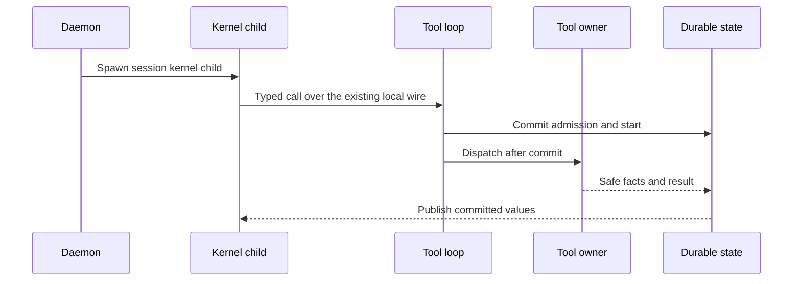

# Gateway/RLM Bridge

**Approved future design. Not implemented; activation requires an activating specification.**

Owner: architecture 19.

This document owns future kernel-child ingress, safe delivery of committed results, cancellation propagation, and
bridge-local recovery classification. It applies only to future run execution. Retained RLM bridge, child, and
activity material remains research provenance and historical-only where it conflicts with architectures 15--18.

## Ownership and one capability path

The removed execution-meaning envelope and decoders ([architecture
02](02-dto-and-contract-policy.md)) leave no live path; 15 owns the
fixed tool set, frozen tool selection, direct admission, model-tool loop, `ToolCallId`, generic effect evidence, and
recovery; 18 owns MCP connection records, discovery, method lists, invocation, and recovery.

This document owns only the spawned kernel child's typed-client ingress, safe delivery of committed results,
cancellation propagation, and bridge-local recovery classification; it is not a second registry, gateway,
daemon, lifecycle, tool implementation, child executor, MCP client, provider selector, persistence authority, sandbox,
or OS privilege boundary.

Python/RLM facade code, direct model ingress, kernels, children, MCP servers, providers, adapters, bridge connections,
current configuration, readiness, evidence, and retained RLM identities cannot create or widen
tool, lifecycle, child, or reconciliation authority; every invocation reaches architecture 15's one daemon-owned,
Rust-owned capability path.

## One spawned child and one typed client

The daemon spawns the session's IPython kernel as its own child process ([architecture
20](20-ipython-kernel-lifecycle.md)). The child holds the existing typed client for that process; the daemon recognizes
the caller as its spawned child from its own process bookkeeping and resolves the session, executing run, model step,
and turn from the daemon-assigned cell reference of the execution window it opened, never from a caller-supplied value.
There is no durable grant record, attachment handshake, or
caller-selected identity: the client is process-local transport, not a credential, semantic selection, lifecycle
permission, policy decision, or capability. Nothing joins the future typed run record: the run's frozen tool selection,
model step, and admission already carry everything a call needs.

The client rides the repository's existing typed local wire ([architecture
03](03-daemon-transport-and-adapters.md)) on its existing private per-user Unix-socket/Windows-named-pipe endpoint, its
live wire-version byte, bounds, and OS-user access boundary. There is no second local listener, TCP/HTTP endpoint,
remote attachment, sandbox, or daemon, and no added handshake, method table, or version negotiation: the child sends
architecture-15's typed tool invocation through the existing typed local request path and receives architecture-15's
ordinary records and frames. An unsupported request fails with a typed error before a partial result or live
notification is delivered.

## Ingress, admission, and dedupe

Every kernel-originated call is an ordinary architecture-15 call. The daemon assigns the canonical `ToolCallId`, which
remains the one identity for that call's durable records and stream frames; an equal repeat within one turn dedupes
against the turn idempotency key ([architecture 04](04-sessions-runs-events-and-storage.md)) and returns the existing
evidence instead of admitting a second action. Admission is architecture 15's three outcomes — `Admitted`, typed
`Incompatible`, typed `Unavailable`; quota, parent, Goal, Skill, provider, MCP, or bridge-specific authorization cannot
be introduced.

Before the call start boundary, an admitted call that never started records `InterruptedBeforeStart` on daemon
recovery; once the call has started, a repeat is read-only and returns only durable evidence, never re-executing.



## Delivery, cancellation, and recovery

Results, fragments, and publication are architecture 15's records alone, demultiplexed by `ToolCallId`; the bridge adds
no second start marker, result stream, terminal-result frame, commit boundary, or ordering record, and it reuses
architecture 15's effect, before-start/interruption, partial-result, cancellation, and recovery rules rather than
restating them.

Channel close does not stop a run; the run stop remains owner-controlled and the bridge only propagates it. `run.cancel`
signals the registered in-flight call, which ends with its bounded `Partial` result and notice ([architecture
20](20-ipython-kernel-lifecycle.md)); late frames after a stop, terminalization, or restart are non-authoritative and
cannot append durable records.

Bridge recovery classifies unfinished calls only from durable evidence and rebuilds safe projections only from
supported records; it never reattaches a kernel, retries a tool, recreates a child, or reconstructs meaning from
current registry, configuration, kernel, process, or graph state. Post-restart lookup is read-only; later work requires
a new `RunId` and fresh admission.

## Child, MCP, and protocol boundaries

For `sub_agent`, the bridge performs only generic ingress and architecture-15 admission, returns only safe references
and result projections, and assigns no child identity, control, message, terminalization, or authority. A child never
inherits a live kernel process, namespace, provider continuation, MCP connection, process handle, or unfinished
effect, and a child run requires its own fresh admission.

Bridge transport may carry only architecture-18 safe MCP projections and cannot discover, invoke, reattach, or
recreate MCP work. Reconnect re-reads current state; there is no event tail, cursor, or resynchronization, and bridge
delivery cannot create a bridge-owned sequence, start a child, rediscover/invoke MCP, or execute external work.

## Bridge detail: bounds and safe failures

The spawned child's typed client adds no transport, bound, or deadline of its own: it uses the existing local wire and
its frame bound, the host's slow-peer path, and architecture 15's durable record bounds ([architecture
03](03-daemon-transport-and-adapters.md)). There is no broader buffer, alternate deadline,
truncation rule, or unbounded queue, and a slow or detached peer is bounded without blocking execution, persistence, or
healthy peers. The bridge keeps no unfinished-call counter: each call passes architecture 15's admission contract
before any external action, and the bridge never treats channel state as authoritative or repeats external work.

The closed bridge safe failures through `ErrorDto` are:

```text
daemon_tool_gateway_required
bridge_authority_unavailable
```

A caller that would reach a tool or primitive path directly fails `daemon_tool_gateway_required`; a kernel-originated
call the daemon cannot resolve to its spawned child and active run fails `bridge_authority_unavailable` before effect.
They disclose no credential, path, raw input, Python/Jupyter value, provider resource, process topology, or
implementation detail.

## Compatibility, dependencies, and non-goals

M4 provider kinds remain `openrouter` and `generic-chat-completion-api`; model names do not select a provider or bridge
behavior. Historical M4 tool calls remain denial evidence. Historical M3/M4 and retained RLM rows that the current
storage stamp still carries gain no bridge ingress, operation, MCP, Skill, Goal, activity, or policy state, and a
database without that stamp is discarded whole rather than opened, so no current mutable state may reconstruct
missing bridge meaning. Retained RLM `SubAgentId`, `RlmParentLinkDto`, session/run-rooted
trees, policy inheritance, queues, activity identities, and product limits remain historical only; no later bridge may
reference exact legacy bytes, rewrite, normalize, or synthesize future state
([architecture 00](00-principles-and-scope.md)).

This document depends on architectures 15, 18, and 20. Related
owners: 20 owns kernel process/namespace/checkpoint lifecycle; 21 owns Goal, Skill, context, and compaction
(bridge-delivered context is safe immutable projection only); 22 owns provider configuration and reasoning semantics
(bridge delivery uses only safe existing provider facts); 23 owns ordinary Session forks (no live kernel process or unfinished
effect crosses one); 03 owns activity/UI projections (kernel-host calls never become activity authority or
public activity payload). It does not define kernel lifecycle, RLM executor or recursion topology, provider evolution,
Skills, Goals, context, session forks, activity/UI, direct MCP administration, SQL, migrations, wire tags, crates,
Cargo, Makefile/CI, or production implementation.
