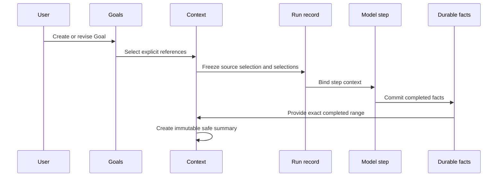

# Goals, Skills, Context, and Compaction

**Approved future design. Not implemented; activation requires an activating specification.**

Owner: architecture 21.

This document owns future Goal context selection and evidence, Skill discovery and selection, the frozen context-source
selection, and immutable compaction. It applies only to future run execution.

## Ownership and non-authorities

The removed execution-meaning envelope and decoders ([architecture
02](02-dto-and-contract-policy.md)) leave no live path; 15 owns tool
identity, frozen direct-tool selection, tool admission, model-tool loop, `ToolCallId`, and generic effect facts; 18 owns
MCP connection records; 19 owns kernel-child ingress, safe committed-result delivery, and bridge-local recovery; 20 owns kernel
epochs, cells, checkpoints, and kernel-local safe projection.

A Goal, Skill, source selection, card, summary, omission, or compaction never creates or mutates a `RunId`, lifecycle
state, tool selection, `WorkspaceRoot`, MCP connection, kernel epoch, provider route, or reconciliation decision.
Context is not a hidden prompt-mutation channel, sandbox, policy engine, or continuation mechanism.

## Immutable selection and Goal context

Admission freezes the run's ordered, revision-pinned selections before a dependent model step begins. Each optional
selection remains exactly `Disabled` or `Selected`. Unknown, corrupt, unsupported, mismatched, or
unavailable required selection blocks dependent future work before a model, provider, tool, process, bridge, kernel,
child, or MCP effect. No current file, catalog, index, Goal, Skill, configuration, UI, ancestry, model,
provider, bridge, kernel, or MCP state may repair missing meaning.

Goal identity, scope, revisions, and session applicability belong to [architecture
28](28-goal-domain-and-verification.md). This document owns the frozen Goal context selection:

```text
ContextSourceSelectionV1
  selection_contract_revision
  ordered_source_references
  source_revision_references
  omission_references

GoalContextSelectionV1
  selection_contract_revision
  ordered_goal_references
  ordered_applicability_link_references
  safe_acceptance_projection_revision
```

A selected reference freezes typed identity, revision, scope, and safe acceptance/evidence projection. A later edit
creates a new Goal revision; it cannot rewrite admitted or model-step context. Goal evidence is not authority:
a Goal cannot create a target, verdict, target mutation, child, or lifecycle transition.

## Skills

A Skill is one bounded textual procedure: a `SKILL.md` entry with a canonical `name` and a bounded `description`, plus
an instructional body. Skills are discovered from exactly two origins: the project directory
`<WorkspaceRoot>/.ir/skills` and the `skills` directory under the user's Intention Relay configuration directory. For
one canonical name the project origin wins over the personal origin; a duplicate canonical name inside one origin is
invalid. Skill text is untrusted instructional content, never authority: it cannot grant, widen, or remove a tool,
provider selection, admission decision, child, MCP connection, kernel epoch, or reconciliation outcome, and it never
enters the instruction channel of [architecture 30](30-instruction-sources-and-system-context.md).

```text
SkillCardDto
  skill_id
  canonical_name
  description
  origin           (Project | Personal)
  enabled          (Enabled | Disabled)
  exact_revision

SkillRevisionDto
  skill_id
  revision
  name
  description
  enabled
  body             (bounded immutable UTF-8 text)

SkillSelectionV1
  ordered references { skill_id, exact_revision }
```

Bodies are bounded immutable UTF-8 text only: no binary, image, executable code, shell template, install instruction,
plug-in runtime, raw schema, arbitrary URL or header, endpoint, credential, provider/SDK value, or process handle. A
disabled record is invisible to selection. Discovery lists the applicable enabled cards in deterministic canonical-name
order pinned to one exact revision; the model compares the request to a card's `canonical_name` and `description`
and selects one exact revision before the body is attached to its model step. A selected revision is immutable: a later
edit, disable, or removal affects future discovery only and never rewrites an admitted run, child, fork, or historical
selection. Unknown, disabled, stale, or over-limit material blocks only the dependent attachment before external work.

Skill records are session-scoped and committed in exactly one session under the one-transaction state-change law of
[architecture 04](04-sessions-runs-events-and-storage.md): `SkillSelected` and `SkillBodyAttached`. The closed failures
are `skill_invalid`, `skill_disabled`, `skill_unknown`, `skill_revision_stale`, `skill_content_too_large`, and
`skill_name_collision`; none reveals a body, path, or implementation resource. One frozen `SkillSelectionV1` rides the
run's immutable selection record, for a goal-directed run and an ordinary run alike. A child run receives only exact
selected values explicitly selected for it. Forks retain the exact selected references in their immutable base
snapshot. The project script library ([architecture 20](20-ipython-kernel-lifecycle.md)) is not a Skill: a Skill may
name a module only as untrusted instructional text, and the module itself stays an ordinary project file.

## Context sources and model-step context

Same-Session Plan-to-Build continuation may retain the conversation as model context, but it must bind the approved plan
revision and create a fresh Build run. Conversation history is context evidence, not proof of current mutable state or
completion of an earlier effect. Before mutation, the Build run must revalidate mutable project and external state. An
optional new-Session handoff materializes the full available safe conversation context, approved plan, and execution
prompt into an immutable credential-free snapshot; it never transfers live runtime resources, credentials, queues, or
unfinished effects.

The frozen source selection binds identities, revisions, and declared semantic order; it is immutable before the next
affected model step and is never widened afterwards. There is no per-step context record: each model step is built from
the selection plus durable history, and the provider request built from it is a mutable window under [architecture
08](08-model-protocol-and-providers.md) that compresses the largest
tool-role results in place when the request estimate crosses the configured context window. Every durable fact stays
recorded as written.

Memory is ordinary markdown the user and model maintain in the workspace, and the model reads it with the existing
six-tool set ([architecture 05](05-tools-and-workspace.md)). No memory records, scopes, cards, or replacement links
exist, and no context selection carries memory state.

## Compaction, cancellation, and recovery

Compaction creates an immutable safe summary over an exact ordered set of **completed** durable history. It retains
source ranges, compaction policy/version, omission evidence, and exact uncompacted suffix. Original
durable facts remain authoritative and are never deleted, replaced, or reinterpreted by a summary. A compaction cannot
cover unfinished or interrupted effects, synthesize completion, reorder history, create authority, or become
continuation/recovery state.



Cancellation, terminalization, selection replacement, or restart blocks later attachment and model
steps as applicable but cannot rewrite an already committed model step or summary. Late source, card, retrieval,
attachment, or compaction output after cancellation, terminalization, replacement, or restart is non-authoritative and
cannot append facts.

Context recovery may validate persisted supported references, but never re-attaches context, recompacts, fetches current
catalog/file/index content, resumes/retries work, or reconstructs a selection from mutable state. Unsupported, corrupt,
or missing selected context blocks only dependent future work before effect; unrelated readable history stays isolated.

## Child, MCP, bridge, kernel, and protocol boundaries

A child receives only separately selected frozen safe references; it never inherits a live source selection, Goal
applicability, Skill selection, kernel namespace/checkpoint, provider continuation, MCP connection, process, or
unfinished effect. MCP, bridge, and kernel context is safe projection only: context cannot discover or invoke MCP,
issue a bridge ingress request, create a kernel epoch, restore a checkpoint, or cause a host request. Future delivery
uses typed read-only current-state projections over the single typed connection ([architecture
03](03-daemon-transport-and-adapters.md)); reconnect re-reads current state, and there is no event tail, cursor, or
resynchronization. Partial delivery is never permitted.

## Dependencies and non-goals

This document depends on architectures 15 and 18--20. It does not define actual Goal persistence,
search/index/vector retrieval, instruction assembly (owned by [architecture
30](30-instruction-sources-and-system-context.md)), SQL/wire tags, migrations, retention/deletion/encryption,
source-page sizes, resource values, provider evolution, architecture-23 session branching, activity-journal and UI
delivery, physical Plan artifacts, direct MCP administration, Python/Jupyter process behavior, Cargo, Makefile/CI, or
production activation.

Architecture 22 owns provider configuration and reasoning normalization. Provider may declare compatible reasoning
input requirements, but only this document selects sources and the model-step context window;
provider cannot scan or inject historical context. Architecture 03 owns the flat activity journal and notification list.
Context records may be referenced only through safe selected provenance and never becomes activity authority or a hidden
presentation channel.
