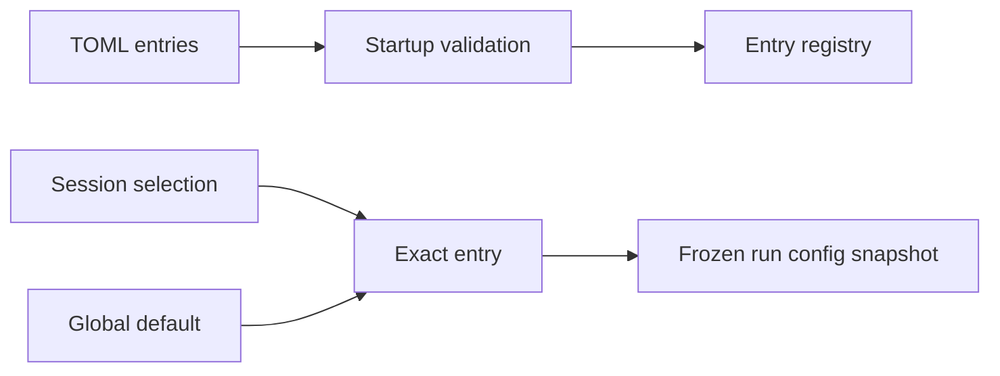

# Provider Configuration and Reasoning

**Approved future design. Not implemented; activation requires an activating specification.** The named provider
entries, the session selection, and the reasoning surface are accepted directions awaiting an activating
specification; none of those surfaces exists in the tree, and `responses` remains not activated. The M4 configuration
accepts one `[provider]` table; the entries list below replaces it when Slice 4 activates.

Owner: architecture 22.

This document owns provider entries, the provider/model selection that resolves into a run, endpoint and
credential-transport semantics, private adapter translation, provider-local availability, and normalized textual
reasoning. It applies only to future run execution; `openrouter` and `generic-chat-completion-api` remain the only M4
kinds. Provider/model discovery and typed configuration editing are owned by [architecture
25](25-configuration-provider-control-plane.md), the session-selection protocol by [architecture
29](29-provider-session-and-profiles-protocol.md), and the TOML file, its parsing, and credential isolation by
[architecture 09](09-configuration-security-and-observability.md).

## Ownership and non-authorities

No run-execution meaning or historical-compatibility layer exists: architecture 02 owns the typed serde JSON records,
and the binary codec with canonical records, digests, and decode classes has no live path; 15 owns the
registry, tool loop, model-step identities, and local tool exchange; 18 owns MCP; 19 owns bridge ingress; 20 owns kernel
lifecycle; 21 owns source selection and immutable model-step context; 08 owns the request contract, the driver
translation, and the same-run reasoning echo.

A provider entry, model ID, endpoint, reasoning value, adapter, output, or availability observation cannot create a
`RunId`, lifecycle transition, tool selection, MCP connection, kernel epoch, context projection, branch, or
reconciliation result.

## Provider entries and the configuration shape

The configuration holds a bounded list of named provider entries plus one global default:

```toml
default_provider = "local"

[[provider]]
name = "local"
kind = "generic-chat-completion-api"   # or "openrouter"
model = "<model-id>"
endpoint = "https://<provider>/v1"     # required for generic-chat-completion-api
credential = "<your-api-key>"
# optional: reasoning_effort = "<closed level>"
# optional: auth_header = "X-Api-Key"  # the one bearer replacement for a custom endpoint
```

Entry rules:

- `name` is a unique bounded token; it is the entry's identity, and no separate profile ID, revision, or descriptor
  exists;
- `kind` is a closed code-owned value: `openrouter` or `generic-chat-completion-api` today, with `responses` as a
  future first-party kind; any other spelling fails startup;
- `reasoning_effort`, when present, is a closed level applied to every request of a run that selects the entry;
- `auth_header`, when present, names the one request header whose complete value is the entry's credential, replacing
  bearer authorization;
- an entry may not be renamed in place: rename is removal plus a new entry, and a stored session or run selection that
  names an absent entry resolves as a closed unavailable projection and is never mass-rewritten;
- no versioned profile revisions, descriptor revisions, driver-contract revisions, capability envelopes, catalog
  tables, tombstones, or removal history exist. The TOML document is the only catalog state.

The entries are parsed, validated, and built once at startup before the ready state. An invalid or internally
inconsistent document (an unknown kind, a duplicate name, a default naming no entry) fails startup loudly, and restart
is the only way to apply changes. The startup build may parse endpoints and create private clients but cannot perform
DNS, HTTP, credential testing, telemetry, model discovery, or background provider work.



## Selection and credentials

A run resolves exactly one entry: the session's selected entry name when one is set, otherwise the global default. One
entry per run, no fallback chain, and no reroute: an unavailable exact selection fails the original `RunId` with
`provider_configuration_unavailable`, a closed detail, and recorded provenance, with no provider call. The resolved
entry's safe fields are frozen into the run's configuration snapshot ([architecture
09](09-configuration-security-and-observability.md)); the session selection affects future runs only and never rewrites
a persisted run.

Every entry holds one opaque literal credential in private composition state. The only selected transports are bearer
authorization or the entry's one named header whose complete value is that credential. Credentials are non-serde and
non-`Debug`, never compared or deduplicated, and absent from typed records, persistence, protocol, logs,
diagnostics, adapter projections, and model context. Credential-only replacement may supply fresh private material
after restart when every safe selected field still matches; the startup boundary is the only credential path, and
there is no rotation command.

An endpoint is credential-free execution metadata only after strict validation: absolute HTTPS with a non-root API base
path. HTTP is permitted only under an explicit loopback policy for exactly `localhost`, `127.0.0.1`, or `[::1]`. Reject
userinfo, query, fragment, controls, malformed percent escapes, aliases, and private-LAN expansion. `openrouter` uses
its first-party default endpoint and accepts no override; `generic-chat-completion-api` requires an explicit endpoint;
a future `responses` kind defaults to `https://api.openai.com/v1` and may use a compatible explicit override. Raw or
secret-bearing URL input is never public or durable identity.

## Adapter translation and reasoning

Provider adapters own their closed request dialect and native stream normalization; they do not source context.
Architecture 21 alone selects source references and the model-step context window, so an adapter cannot scan
sessions/ancestors/siblings, construct history from current state, inject prior reasoning, or compact content. A
provider contract that requires the session's own earlier steps back verbatim is the open `@todo(provider)` of
[architecture 08](08-model-protocol-and-providers.md); it sources nothing and widens nothing.

The normalized stream carries text, reasoning, tool calls, usage, and terminal events. Reasoning output normalizes as
`ModelEventDto::ReasoningDelta { content }`, the generic adapter consumes the pinned SDK's typed `reasoning_content`
field, and the current round's accepted reasoning rides the assistant tool-call continuation of the same run
([architecture 08](08-model-protocol-and-providers.md)). Cross-run reasoning transfer is `Disabled` in v1: no
manifest, compatibility identity, history bound, fragment category, or summary surface exists, and prior-run,
cross-turn, or fork reasoning injection is forbidden as a source of context.

## Availability

Compatibility and availability are distinct. An entry whose exact model, endpoint, or private material is absent,
disabled, or unavailable is live availability evidence: it creates no `RunId` and permits only a later fresh
admission. Attempts, retries, timeout ownership, and recovery are owned by [architecture
08](08-model-protocol-and-providers.md); no default, same-model, alternate endpoint, kind, or current-TOML fallback
exists.

## Provider kinds and record state

Provider selection is explicit configuration. The only configuration kind strings are `openrouter` and
`generic-chat-completion-api`; the latter preserves any non-blank model ID without model-name classification. A record
carries only state it recorded, a generic model ID stays generic, and no legacy selection bridge or synthetic binding
exists.

## Dependencies and non-goals

This document depends on architectures 15 and 21. It does not define a Responses SDK or adapter, credential
entry/keychain, telemetry, multimodal or structured output, plugin adapters, or remote continuation. Discovery and
typed configuration editing belong to the not-activated Slice 4
([architecture 25](25-configuration-provider-control-plane.md)) with restart-only application.

Architecture 03 owns the activity journal and notification list; provider and reasoning records may be safely projected
only through their existing owners and never expose raw native data, select a provider, or create activity authority.
