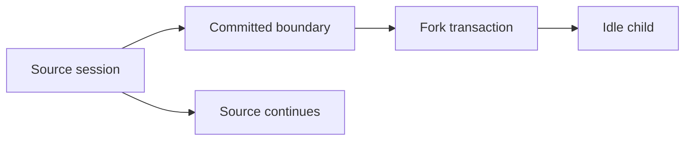

# Non-Destructive Session Branching and Regeneration

**Approved future design. Not implemented; activation requires an activating specification.**

Owner: architecture 23.

This document owns future ordinary Session branching, conversation lineage, frozen fork context, regeneration, lineage
audit, and branch presentation. It applies to future ordinary Session branching only.

## Ownership and non-authorities

Architecture 04 owns current Session/Run persistence and recovery. Run-execution meaning and historical compatibility have
no live path: neither is a record family ([architecture
02](02-dto-and-contract-policy.md)). Architectures 15, 18, 19, and 20 own tool, MCP, bridge, and
kernel semantics. Architecture 21 owns Goal, Skill, and context-source semantics. Architecture 22 owns provider configuration and
reasoning semantics.

A conversation branch is not an RLM parent link, activity aggregate, provider continuation, tool permission, kernel
epoch, MCP connection, or authority.

## Branch identity and user workflow

The Plan/Build workflow may optionally use ordinary Session lineage for an implementation handoff after plan approval;
the default path is same-Session continuation and is not a fork. An opted-in handoff creates an independent child
Session from the approved plan and full available safe conversational context, then may start a fresh Build Autopilot
run. It transfers no live runtime state, credentials, grants, provider requests, or unfinished effects; the
source Session remains unchanged.

History is append-only. A user fork creates a new independent child `SessionId` and leaves the source unchanged.
“Rewind” is explanatory language only: it never truncates, replaces, deletes, rolls back, or switches the source history
or an external effect.

Every root and descendant form one tree rooted at the root session's `SessionId`. A child records its immediate
`ParentSessionId`, caller-stable `ForkOperationId`, and immutable `ForkBoundaryDto`. Forks remain within one
`ProjectId`, `WorkspaceId`, and immutable `WorkspaceRoot`.



`Regenerate response` is an ordinary new run in the same Session, appended after the committed turn and bound to the
parent `RunId` it regenerates; it never forks, truncates, replaces, or rewrites history; a failed start leaves the prior
response committed.

## Closed boundaries and frozen context

`ForkBoundaryDto` has exactly these variants:

- `CommittedUserTurn`: a committed user turn whose run has started and that is not pending. The child receives that
validated user text once through a new child anchor and receives no response fact from that run.
- `CompletedAssistantTurn`: a genuinely completed run with one valid terminal `Finished` fact, no terminal failure,
pending interaction, or unfinished external action. A valid empty response adds no synthetic assistant message.

Pending turns, partial assistant batches, failed, interrupted, incomplete, waiting,
or unfinished work are ineligible; source activity does not block an eligible fork, but pending input, active runs,
waiting interaction, admitted work, and external effects never cross it.

`fork-model-context-v1` is a closed ordered text-only causal projection from committed source facts at the selected
boundary. It includes validated user messages and only eligible final nonblank assistant messages. It excludes reasoning
text/summaries, attempts, usage, tool calls/results, child results, raw provider data, and
opaque continuation state. Unsupported material rejects rather than truncates, omits, or uses current
state. A later implementation uses the stored compatible schema unchanged, defines a separately versioned compatible
projection, or blocks the dependent operation.

## Base snapshot and workspace state

Every child owns one flattened credential-free `ForkBaseSnapshotDto`; nested forks never require runtime traversal of
ancestor or sibling history. The child context starts from its own snapshot and adds only child-owned later history.
Missing, corrupt, unknown, or incompatible data blocks dependent work before an effect and never falls back to a live
source, current catalog, provider, file, index, registry, bridge, kernel, MCP, or UI state.

Cross-run reasoning transfer is `Disabled` in v1 ([architecture
22](22-provider-evolution-profiles-and-reasoning.md)), so no fork record carries reasoning references.

`WorkspaceStateDto::Unverified` is the only initial workspace-state value. It makes no claim about files, processes,
repositories, remote systems, or effects. A fork never clones or rolls back machine state.

## Atomic lineage and idempotency

Future storage adds the base snapshot record and the fork-operation idempotency record under the one-transaction
state-change law of [architecture 04](04-sessions-runs-events-and-storage.md); the child's lineage lives on the
ordinary session row.

One transaction validates the source head, then commits the child projection, lineage,
base snapshot, optional anchor, and idempotency result; no external action occurs inside it.

No synthetic fork provenance record is allowed.

Equal operation identity and command semantics return the same child without new records. Changed reuse, stale source
state, ineligible boundary, unavailable history, unsupported snapshot, or unavailable reference fails
closed before a side effect. A failed transaction leaves no partial child, lineage, base snapshot, or operation
binding.

## Presentation and protocol

Titles and reversible archive state belong only to their ordinary Session. They never rewrite lineage or base snapshots.
Archive requires an idle session; archived sources remain readable and forkable.

Session lineage is ordinary-session structure only; it never constrains run admission or child creation. A fork carries
no depth, descendant-count, source-boundary rate, or base-snapshot size limit
([architecture 09](09-configuration-security-and-observability.md), [architecture
15](15-tool-registry-and-model-tool-loop.md)). The title bound remains an intrinsic
representation constraint where its owning field table requires it.

The typed fork preview, fork, branch-level, rename, archive, and restore DTOs, plus the ordinary regeneration run start
carrying the parent `RunId` it regenerates (the concrete field lands with the activating specification), are exposed as
ordinary typed requests over the single local connection; no negotiated family or capability gate precedes them
([architecture 03](03-daemon-transport-and-adapters.md)). Tree reads are bounded
immediate-child projections in stable creation order. They are not tree-wide event streams. A peer that does not
speak the live wire fails closed with the typed `invalid_local_protocol_response` error before any request is
served.

## Detailed protocol DTOs, field tables, and bounds

The fork public DTOs are:

```text
ForkSessionCommandDto
ForkSessionResultDto
GetForkPreviewQueryDto
ForkPreviewDto
GetConversationTreeQueryDto
SessionBranchesDto
ConversationBranchSummaryDto
RenameSessionCommandDto
ArchiveSessionCommandDto
RestoreSessionCommandDto
```

`ForkSessionCommandDto` contains source session identity, the typed boundary, `ForkOperationId`, expected source
sequence, and an optional validated title. It
never accepts a client-selected child ID, raw snapshot, raw event, configuration path, credential, workspace path, or
opaque implementation value. `ForkSessionResultDto` is bounded and returns the child identity, the immediate parent,
and the root identity, accepted boundary, optional child-anchor `TurnId`, snapshot and context schema versions,
inherited future defaults, and the closed `unverified` workspace notice; it does not return the base snapshot inside a
transport response.

`GetForkPreviewQueryDto` takes only a source session and a candidate typed boundary. `ForkPreviewDto` returns a fresh
source sequence, accepted boundary data, safe inherited future defaults, the deterministic fallback title, counts and
safe types of what the child inherits, and the closed `unverified` workspace state. It carries no materialized
instruction text, no materialized model messages, and no stored copy of the reference lists: the counts summarize them,
and the source session keeps them.

A fork child begins idle and owns no run-start path of its own: every child run starts from an ordinary user turn under
the normal admission rules, with the frozen context already in place as the child's own history.

`RenameSessionCommandDto`, `ArchiveSessionCommandDto`, and `RestoreSessionCommandDto` each carry a session ID and
`expected_ordinary_session_sequence`; rename also carries a `SessionTitleDto`. A stale sequence fails
`session_changed`. A command that already observes its requested presentation state succeeds with `changed = false`
and appends no durable record. Archive still performs its mandatory idle check before either outcome.

`GetConversationTreeQueryDto` takes one `SessionId`. `SessionBranchesDto` returns that session's root summary, the
session's own summary, and its immediate children in stable creation order. A tree is intentionally live between reads:
new, renamed, archived, restored, or otherwise changed branches appear in the next read, and no read promises a
revision-consistent tree snapshot.

`ConversationBranchSummaryDto` exposes only branch identity, immediate parent, creation ordering data, safe title or
stable fallback, archive state, mode, fork point, and `unverified` workspace state.
The immutable base snapshot and its retained source content are not list data. Tree and lineage reads validate that
every named session belongs to the same root, project, and workspace.

`SessionTitleDto` is bounded to 128 Unicode scalar values after trim and NFC normalization, and rejects blank, control,
and bidi-override characters. An adapter may request a title when it forks; otherwise the daemon stores a deterministic
safe title derived from the source title or its stable fallback and the fork point. A root session without a stored
title uses only the stable presentation fallback until renamed. Rename changes one session only, writes its stored
title, and never changes lineage, a base snapshot, or a tree-wide title.

### Field tables

Fork snapshot, preview, and command records are typed serde JSON shapes; no framing, type-tag, length-prefix,
canonicalization-version, or digest layer wraps them ([architecture
02](02-dto-and-contract-policy.md)). Under the single-version policy ([architecture
00](00-principles-and-scope.md)) each record keeps exactly one live shape.

- `fork-base-snapshot`: `1 schema_version`, `2 context_schema_version`, `3 source_session_id`, `4 boundary`,
`5 source_boundary_sequence`, `6 effective_instruction_text`, `7 materialized_model_messages`, `8
inherited_future_defaults`, `9 workspace_state`, `10 inherited_references`.
- `fork-preview`: `1 preview_schema_version`, `2 source_session_id`, `3 boundary`, `4 source_head_sequence`,
`5 inherited_future_defaults`, `6 workspace_state`, `7 inherited_reference_counts`. Field 4 is
the source head observed by the preview, not the selected boundary sequence; field 7 carries the
counts and safe types of what the child inherits, read from the source records rather than stored in the preview.
- `fork-command`: `1 source_session_id`, `2 boundary`, `3 expected_source_sequence`, `4 title_present`,
`5 requested_title`, `6 fork_operation_id`.

The former `canonical_snapshot_digest`, `model_context_digest`, and `fork-command` digest construction are removed with
the codec ([architecture 02](02-dto-and-contract-policy.md)). A command binds to the exact source state the client
accepted through `expected_source_sequence`, which the fork transaction validates; no canonical digest and no preview
binding are part of the current contract.

`inherited_references` is the frozen reference set a child inherits: the applicable project-Goal links and the selected
summary reference ([architecture 28](28-goal-domain-and-verification.md)), the selected role cards, and the run's frozen
`SkillSelectionV1` ([architecture 21](21-goals-skills-context-memory-and-compaction.md)), each at the exact revision the
source held at the selected boundary. A fork retains them verbatim, and a preview reports their counts and safe types
instead of the values.

`effective_instruction_text` carries the frozen instruction text of
[architecture 30](30-instruction-sources-and-system-context.md), materialized
when the fork is created. A child
inherits the text verbatim; no fork, regeneration, or later run re-derives it from current configuration,
current project instructions, or current session state.

### Fixed bounds and audit taxonomy

The fork's representation bound — the 128-NFC-scalar session title — is the conversation-tree row of the limits registry
in [architecture 09](09-configuration-security-and-observability.md), where every numeric bound in the system is recorded
with its classification and reason. It is enforced inside the fork transaction before any partial child record exists,
and an out-of-bound title is a typed policy result rejected before the presentation event, never an oversized transport
frame, partial branch, or unstructured storage error.

The conversation tree has no depth, descendant-count, or branch-count bound, and a base snapshot has no canonical size
limit ([architecture 09](09-configuration-security-and-observability.md), [architecture
15](15-tool-registry-and-model-tool-loop.md)): a fork and a tree read are bounded
only by the title representation bound above, and a read whose branch list exceeds the transport envelope is answered
with the typed `local_protocol_message_too_large` failure. Boundaries, base snapshots, lineage, and idempotency records
remain indefinitely readable under the initial archive-only retention policy.

Fork provenance is stored as committed records: fork, anchor materialization, rename, archive, and restore each commit
a durable record alongside the ordinary session and run records. Generic metadata records and a synthetic
source-session fork record are not acceptable audit boundaries.

A fork copies no usage: `fork-model-context-v1` excludes it and the base snapshot has no field for it, so inherited usage
is never charged to the child a second time. Child totals count only the child's own runs, and a tree aggregate sums each
run once, because every run belongs to exactly one session ([architecture
04](04-sessions-runs-events-and-storage.md)).

The closed fork safe failures through `ErrorDto` are:

```text
fork_context_schema_unsupported
fork_history_unavailable
fork_snapshot_unsupported
fork_reference_unavailable
fork_operation_conflict
fork_source_changed
fork_boundary_ineligible
session_archive_not_idle
session_changed
```

They disclose no credential, path, source content, raw provider data, or implementation resource.

## Compatibility, dependencies, and non-goals

No migration exists: a database under an older stamp is discarded and recreated. A root session carries no lineage
record, and no synthetic parent/anchor/run/event is written.

A fork begins with no run and no execution authority. It cannot transfer a provider request/client/credential, tool
action, kernel task, MCP process, or unfinished effect. Later child runs select their own immutable
provider meaning. Regeneration is never a continuation: it resolves under ordinary admission and follows the
session's provider selection ([architecture 29](29-provider-session-and-profiles-protocol.md)).

This document depends on architectures 04 and 15--22 plus the DTO, transport, security, verification, and quality
policies. It does not define activity-journal or UI implementation, workspace cloning/rebinding, autonomous
model/IPython forking, provider implementation, destructive deletion/GC/export, schema, migrations, crates, Cargo,
Makefile/CI, or production activation.

Tool-result execution, child-agent execution, export, and cross-workspace clone/rebind are accepted post-M5 future
directions, to be executed in Milestone 5+:

- tool-result execution and child-agent execution are separately admitted ordinary fork actions from frozen references,
never silent re-execution;
- export is a bounded, credential-free surface for fork lineage and activity records, never a history rewrite and never
destructive deletion;
- cross-workspace clone/rebind is explicit user-authorized only, never implicit, and never transfers live state or
authority.

Architecture 03 owns the flat activity journal and notification list. A child run is an ordinary run: it creates no
second lineage, implies no authority, and proves no rollback.
