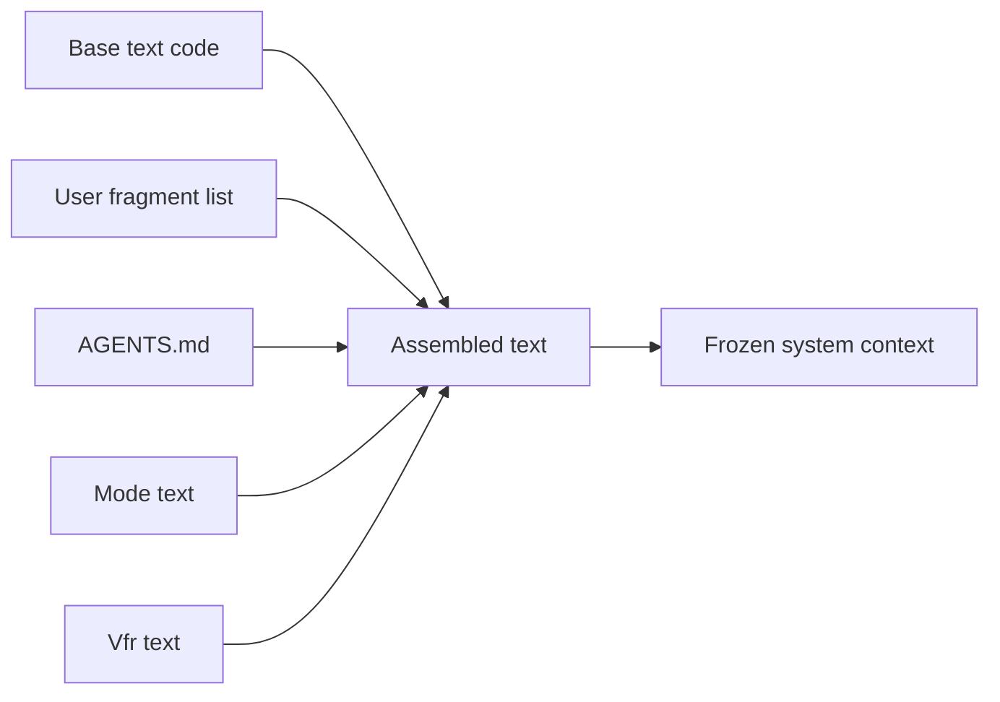

# Instruction Sources and System Context

**Approved future design. Not implemented; activation requires an activating specification.** Architecture 30 owns the
instruction channel of a model request: instruction sources, canonical assembly, the frozen instruction text, its
failures, and observability. It follows the single live version and no-backward-compatibility policy ([architecture
00](00-principles-and-scope.md)); delivery belongs to the third activating slice of Milestone 5+.

Owner: architecture 30.

## Ownership and non-authorities

This document owns the source model, the canonical assembly order and separators, the frozen instruction text, its
closed failures, and its observability rules. Architecture
21 owns Goal, Skill, context-source selection, and compaction semantics; instruction sources are not a
context source and never enter a context selection, a Skill selection, or a model-step context. Architecture 23 owns
fork lineage and the frozen records that carry the materialized text. Architecture 07 owns the `Mode` contribution
text; architecture 06 owns the `Vfr` contribution content and its configuration dependency; architecture 08 owns the
request contract and driver translation; architecture 09 owns configuration loading and credential isolation, while
this document owns the classification of instruction content and its redaction rules. Architecture 25 owns no
instruction commands: instruction configuration is filesystem-level.

Instruction text is not authority: it cannot create, widen, or remove a tool, provider selection, admission
decision, child, MCP connection, kernel epoch, or reconciliation outcome, and it
cannot prove that an external effect did or did not happen.
The channel applies to newly admitted runs only; historical M3/M4 requests and runs keep their recorded meaning and gain
no instruction state.

## Instruction sources

The channel draws on exactly three configurable sources plus two reserved contributions:

| Source | Content | Editing |
| --- | --- | --- |
| Base instruction text | The daemon's own leading instructions (the adapted legacy identity, guideline, tool-usage, and coding-convention text as one block). | Code-owned constant; not configurable. |
| User fragment list | One ordered list of user-authored text fragments. | Filesystem-level configuration, in listed order. |
| Project instructions | The workspace `AGENTS.md` under the session `WorkspaceRoot`. | Project file, addressed by workspace path. |
| `Mode` contribution | Plan/Build policy instruction, owned by architecture 07. | Reserved contribution. |
| `Vfr` contribution | VFR placeholder/expansion instructions, owned by architecture 06. | Reserved contribution, configuration-dependent. |

There are no instruction kinds, scopes, per-source enable flags, declared-order fields, or source revisions: the
fragment list's order is the list's order, and the two reserved contributions exist exactly when their owners supply
them. A source carries no authority, no executable content, no credential, no provider or tool payload, and no
implementation resource. Instruction text is UTF-8 configuration content; content that is not representable as UTF-8
text fails closed.

## Canonical assembly and the frozen instruction text

Assembly happens once per admitted run, before the first model step:

1. the base instruction text;
2. the user fragment list in listed order;
3. `AGENTS.md`;
4. the `Mode` contribution;
5. the `Vfr` contribution.

Contributions are joined by a fixed separator whose bytes are part of the frozen text; the separator is the legacy
`\n\n---\n\n` join. The order and the separator are fixed by this document and can only change by a new decision.



The assembled text is frozen before the first model step of the run. Every later model step of the same run reuses
it; a fork inherits the materialized text verbatim; a plan handoff materializes it into its frozen snapshot;
regeneration, reconnect, and audit never rebuild it. No path may re-derive instructions from current configuration,
current `AGENTS.md` content, current session state, or a live ancestor. No projection record, contribution revision,
or digest exists; the frozen text is the text itself.

## Workspace project instructions

`AGENTS.md` at the session's `WorkspaceRoot` is the only file-based instruction source.

- The file is addressed by joining its path onto the session's `WorkspaceRoot`;
the root is an addressing anchor, not a security boundary, and no symlink or containment check exists
([architecture 05](05-tools-and-workspace.md)); an unreadable or non-regular file fails closed.
- The file is read as UTF-8 text; its content is never executed, never
parsed as configuration, and never treated as a tool definition or policy input.
- An absent file contributes nothing and is not a failure; a project without
instructions behaves exactly as a project with an empty source.
- The file is project content, not authority: it cannot widen tool policy or
provider selection, and its text is labeled as project material inside
the assembled text.
- The workspace reference, not the text, is durable outside the frozen text
itself.

## Configuration and editing

The user fragment list is configuration content; the user edits it at the filesystem level in the configuration files,
and the configuration takes effect through the ordinary configuration load ([architecture
09](09-configuration-security-and-observability.md)). There is no control-plane, UI, TUI, or CLI surface that lists,
creates, edits, duplicates, enables, disables, reorders, re-scopes, validates, or previews instructions, and
adding any such surface requires a new decision. An invalid or unsupported fragment configuration fails closed through
the ordinary configuration validation of architecture 09.

Instruction configuration is configuration, not admission: once a run is admitted, its text is immutable and
stays the stable leading block of every request, and a later configuration change affects only future runs; the
following request window is mutable under [architecture 08](08-model-protocol-and-providers.md).

## Trust, authority, and the injection boundary

The instruction channel is the only trusted instruction surface of a request, and it accepts content from declared
sources only. Repository content, tool output, fetched material, Skill bodies, provider output, and
model output remain untrusted or evidence-only material and can never be promoted into it; they enter a request only
through the context-selection, Skill-selection, and evidence rules of architecture 21. Instruction text is advisory
and creates no authority; a provider cannot scan, inject, rewrite, or reorder the frozen text, and no driver may add
framing or templating of its own. The daemon-owned request marks the end of the leading instruction block
with the ephemeral prompt-cache breakpoint of [architecture 08](08-model-protocol-and-providers.md), which adds no text
and changes no frozen text.

## Deterministic assembly

Assembly is deterministic: the same base text, fragment list, project instruction content, mode, and resolved
configuration must produce the same ordered contributions and the same assembled text on every platform. Identity is
the text itself; no digest, canonical bytes,
or content addressing exists until a real consumer needs one ([architecture 02](02-dto-and-contract-policy.md)).

## Failure behavior

The closed instruction failure set is:

```text
instruction_source_unavailable
```

- `instruction_source_unavailable`: the workspace instruction source is
unreadable or is not valid UTF-8 text; an absent file is not a failure.

The failure is a typed known pre-effect rejection at admission. It discloses no credential, absolute path, file
content, raw payload, or implementation detail. No fallback revision, partial assembly, silent omission, truncation,
sampling, or historical substitution is permitted, and none of these failures may be repaired by current state.

## Observability and classification

Instruction text is durable configuration content, not a secret and not an activity fact. Logs, activity records,
notification projections, and audit records never carry fragment text, `AGENTS.md` content, or the assembled text, and
a single
regression assertion proves instruction text never appears in logs or activity records. Fragment text is
visible only in the user's own configuration files and the frozen records that carry it; no control-plane, UI,
activity, notification,
audit, or diagnostics surface displays it.
Classification and redaction rules of [architecture 09](09-configuration-security-and-observability.md) apply unchanged.

## Compatibility and historical preservation

M3/M4 requests keep the optional system context absent, and M3/M4 runs carry no instruction state. Historical records
never gain a reconstructed instruction text, and a missing or unreadable materialized text leaves the
dependent fork or handoff blocked while unrelated history remains readable. The mechanism adds no second model protocol,
no second storage schema, and no migration; it is part of the single live first-scope
instruction contract.

## Dependencies and non-goals

This document depends on architectures 04, 06, 07, 08, 09, 21, 23, and 25.
Non-goals: Goal, Skill, context-source selection, or compaction semantics; fork lineage or lineage projection rules;
the model request contract or driver translation; configuration storage, reload, or credential handling; activity,
notification, or adapter behavior; few-shot example selection, memory-derived prompt material, MCP-provided prompts,
date/time/Git/session-derived context injection, provider-native prompt framing, model-specific templates, prompt
tuning, telemetry, A/B evaluation, automatic instruction generation, cross-project instruction sharing, executable or
scripted instructions, and sandbox or privilege claims.

Evidence: activating specification per [architecture 12](12-quality-gates-and-makefile.md).
